# RoadSense AI – Complete Technical Documentation

> A single, detailed reference for everything in this project: data, concepts, model internals, code, metrics, deployment, operations, troubleshooting and extension guides.
> Companion files: [`01_README.md`](01_README.md) (overview) · [`03_Interview_Questions_and_Concepts.md`](03_Interview_Questions_and_Concepts.md) (85 interview questions) · [`04_ML_Project_Report.docx`](04_ML_Project_Report.docx) (formal report).

**Contents**

1. [Scope and summary](#1-scope-and-summary)
2. [System architecture](#2-system-architecture)
3. [File-by-file reference](#3-file-by-file-reference)
4. [Dataset in depth](#4-dataset-in-depth)
5. [Data-preparation code walkthrough](#5-data-preparation-code-walkthrough)
6. [Model in depth (YOLOv8)](#6-model-in-depth-yolov8)
7. [Training reference](#7-training-reference)
8. [Evaluation in depth](#8-evaluation-in-depth)
9. [Application internals](#9-application-internals)
10. [Using the model from code / CLI](#10-using-the-model-from-code--cli)
11. [Deployment and operations](#11-deployment-and-operations)
12. [Reproducibility checklist](#12-reproducibility-checklist)
13. [How-to guides (extending the project)](#13-how-to-guides-extending-the-project)
14. [Test plan](#14-test-plan)
15. [Provenance, known issues and limitations](#15-provenance-known-issues-and-limitations)
16. [Glossary](#16-glossary)
17. [References](#17-references)

---

## 1. Scope and summary

**Goal.** Automatically detect and classify road-surface damage in photographs and videos so that inspection becomes faster, cheaper, more consistent and scalable than manual surveys.

**Task type.** Supervised, multi-class **object detection** (box + class + confidence per damage instance).

**Classes.**

| ID | Code | Name | Visual cue |
|---|---|---|---|
| 0 | D00 | Longitudinal Crack | Thin line along the direction of travel |
| 1 | D10 | Transverse Crack | Thin line across the road |
| 2 | D20 | Alligator Crack | Mesh of interconnected cracks |
| 3 | D40 | Pothole | Bowl-shaped hole, dark interior |

**Headline numbers** (validation set: 1,294 images, 2,272 instances; RTX 2060):

| Metric | Value |
|---|---|
| Precision / Recall / F1 | 0.584 / 0.523 / 0.552 |
| mAP@0.5 | 0.547 |
| mAP@0.5:0.95 | 0.254 |
| Inference | 0.7 ms pre + 9.3 ms model + 3.4 ms post ≈ 13.4 ms/image (~75 FPS) |
| Cloud CPU inference (observed in the deployed app log) | ≈ 160 ms/image |
| Model | YOLOv8s, 168 layers (fused), 11,127,132 parameters, 28.4 GFLOPs, ~85 MB weights |

**Deliverables.** Training notebooks · weights · Streamlit app (image + video) · report · this documentation · README with interview Q&A.

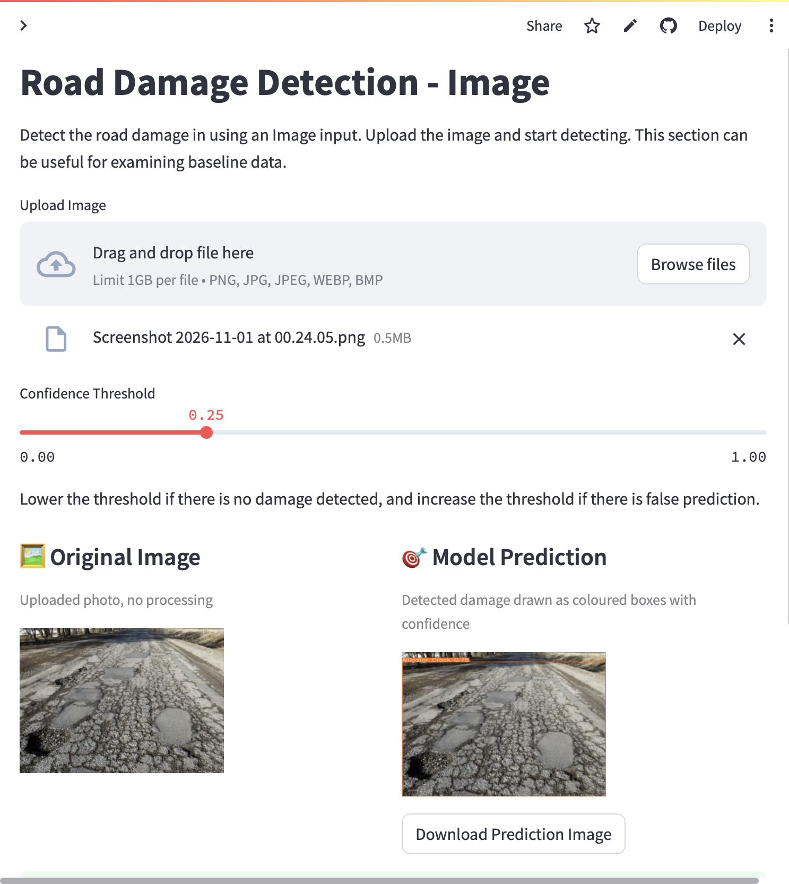{width=55%}

---

## 2. System architecture

### 2.1 Offline (training) side

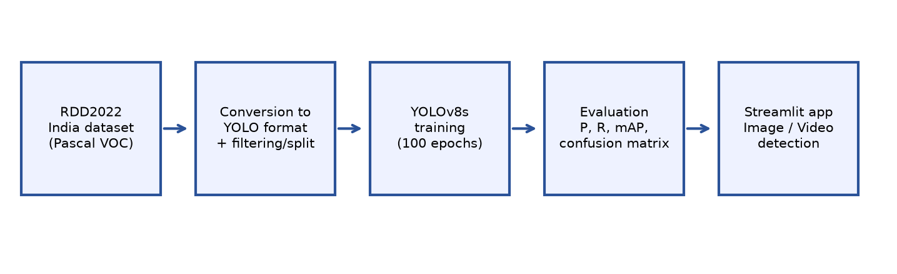{width=95%}

```
RDD2022 India (images + Pascal VOC XML)
        │
        ▼  0_PrepareDatasetYOLOv8.ipynb
 parse XML → keep D00/D10/D20/D40 → normalise boxes → YOLO .txt
        │   + keep ≤10 % background images
        ▼   + shuffle (seed 1337) → 90 % train / 10 % val
  images/{train,val}  labels/{train,val}  rdd_India.yaml
        │
        ▼  1_TrainingYOLOv8.ipynb  (YOLOv8s from COCO weights, 100 epochs)
  runs/…/weights/{best.pt,last.pt}  + curves + logs
        │
        ▼  2_EvaluationTesting.ipynb (model.val)
  P, R, F1, mAP50, mAP50-95, PR curve, confusion matrix
        │
        ▼
  models/YOLOv8_Small_RDD.pt  ← shipped with the app
```

### 2.2 Online (serving) side

```
Browser ──HTTP/WebSocket──► Streamlit server (Python process, one script run per user interaction)
                                  │
                 ┌────────────────┼──────────────────┐
                 ▼                ▼                  ▼
            Home.py     pages/2_Image…py      pages/3_Video…py
                                  │                  │
                                  └──► ultralytics.YOLO(weights) ──► PyTorch (CPU on cloud)
                                  │                  │
                         PIL/NumPy/OpenCV      OpenCV VideoCapture/Writer
                                  │                  │
                         annotated PNG          annotated MP4  (./temp/)
```

Key properties:
- **Stateless model, stateful session.** Weights are loaded once per browser session into `st.session_state`.
- **Streamlit rerun model.** Every widget interaction reruns the page script top-to-bottom; expensive work must be cached or guarded.
- **CPU-only on the free cloud.** CUDA is not available; the CPU wheel of PyTorch is installed.

---

## 3. File-by-file reference

| Path | Role | Details |
|---|---|---|
| `Home.py` | Landing page | `st.set_page_config`, custom CSS (hero banner, cards, chips), lists classes, features, team, placeholder link pills |
| `pages/1_Realtime Detection.py` | Placeholder | Shows "Coming soon" + explanation; no model code |
| `pages/2_Image Detection.py` | Image inference | Upload → normalise → predict → annotate → table → download |
| `pages/3_Video Detection.py` | Video inference | Upload `.mp4` → frame loop → annotated `.mp4` → download |
| `sample_utils/download.py` | Weights downloader | `download_file(url, path, expected_size)` – skips if the file exists with the exact size (89,569,358 bytes), else streams it with a progress bar |
| `sample_utils/get_STUNServer.py` | Legacy helper | Finds the geographically nearest public STUN server for WebRTC. Currently unused (Realtime page disabled) but kept for the future webcam feature |
| `models/YOLOv8_Small_RDD.pt` | Weights | The shipped detector (4 classes) |
| `training/0_PrepareDatasetYOLOv8.ipynb` | Data prep | VOC→YOLO, class filter, background cap, split |
| `training/1_TrainingYOLOv8.ipynb` | Training | `YOLO('yolov8s.pt').train(...)`, resume cell |
| `training/2_EvaluationTesting.ipynb` | Evaluation | `YOLO(weights).val(data=yaml)` |
| `training/dataset/rddIndiaFiltered/rdd_India.yaml` | Dataset config | Paths + 4 class names |
| `training/yolov8n.pt`, `yolov8s.pt` | COCO pre-trained checkpoints | Starting points |
| `training/tools/make_figures.py` | Figure generator | Re-creates the diagrams |
| `resource/` | Result images and demo GIFs | PR curve, confusion matrix, validation batch labels/predictions, banner |
| `requirements.txt` | Python deps | Pinned; first line selects the CPU PyTorch wheel index |
| `packages.txt` | apt deps (Streamlit Cloud) | `libgl1`, `libglib2.0-0` |
| `.streamlit/config.toml` | Streamlit config | `maxUploadSize = 1000` (MB), light theme |
| `.gitignore` | Ignore rules | Bytecode, notebook checkpoints, `temp/*`, training runs/wandb |

### 3.1 Pinned dependencies and why

| Package | Version | Purpose / note |
|---|---|---|
| `torch` | 2.0.0 (CPU wheel) | Deep-learning runtime |
| `ultralytics` | 8.0.201 | YOLOv8 implementation (training, validation, predict, plot) |
| `opencv-python-headless` | 4.8.0.74 | Image/video I/O, resize, colour conversion; headless = no GUI libs |
| `numpy` | 1.24.3 | Arrays (compatible with torch 2.0) |
| `Pillow` | 9.5.0 | Image decoding, EXIF transpose |
| `streamlit` | 1.28.0 | Web UI |
| `streamlit-webrtc` | 0.47.1 | Reserved for the future realtime page |
| `av` | 12.3.0 | PyAV (needed by streamlit-webrtc); 10.0.0 had no wheel for Python ≥ 3.11 |
| `requests` | 2.28.2 | Used by the STUN helper |

---

## 4. Dataset in depth

### 4.1 Origin
**RDD2022** – the data release of the *Crowdsensing-based Road Damage Detection Challenge 2022* (CRDDC2022, IEEE Big Data Cup). About 47,420 images and 55,000+ annotated damages from Japan, India, the Czech Republic, Norway, the United States and China (MotorBike and Drone sub-sets). Images were captured by smartphones/cameras mounted on vehicles ("crowdsensing") and annotated with bounding boxes.

Training-split image counts (from the preparation notebook output):

| Sub-set | Japan | **India** | China-Drone | China-MotorBike | Czech | Norway | USA |
|---|---|---|---|---|---|---|---|
| Images | 10,506 | **7,706** | 2,401 | 1,977 | 2,829 | 8,161 | 4,805 |

Test images are distributed **without labels** (challenge protocol), so we create our own validation split.

### 4.2 Raw layout (India)

```
RDD2022_all_countries/India/train/
├── images/        *.jpg
└── annotations/xmls/   *.xml          (Pascal VOC)
```

### 4.3 Pascal VOC annotation (input)

```xml
<annotation>
  <size><width>720</width><height>720</height><depth>3</depth></size>
  <object>
    <name>D40</name>
    <bndbox><xmin>180</xmin><ymin>150</ymin><xmax>420</xmax><ymax>300</ymax></bndbox>
  </object>
  <object> … </object>
</annotation>
```
Coordinates are **absolute pixels**, origin top-left, corners (xmin, ymin, xmax, ymax).

### 4.4 YOLO annotation (output)

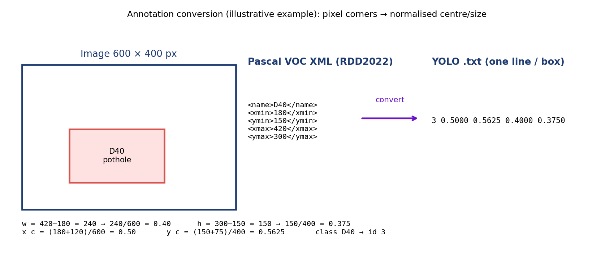{width=95%}

One `<image>.txt` per image; one line per box; space-separated; **all values relative (0–1)** except the class id:

```
<class_id> <x_center> <y_center> <width> <height>
3 0.5000 0.5625 0.4000 0.3750
```
An image with no damage has an **empty** `.txt` file (a "background" image).

### 4.5 Directory layout and YAML consumed by Ultralytics

```
training/dataset/rddIndiaFiltered/
├── rdd_India.yaml
└── India/
    ├── images/{train,val}/*.jpg
    └── labels/{train,val}/*.txt
```
```yaml
path: rddIndiaFiltered
train: [India/images/train]
val:   [India/images/val]
names: {0: Longitudinal Crack, 1: Transverse Crack, 2: Alligator Crack, 3: Potholes}
```
Ultralytics finds a label by replacing `/images/` with `/labels/` in the image path and the extension with `.txt`.

### 4.6 Statistics of the evaluation (validation) split

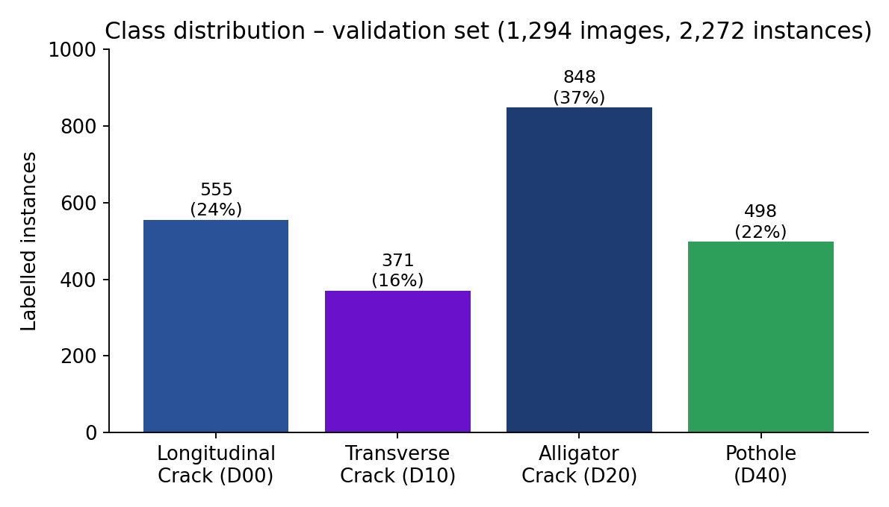{width=60%}

| Property | Value |
|---|---|
| Images | 1,294 (177 backgrounds, 0 corrupt) |
| Instances | 2,272 |
| Longitudinal / Transverse / Alligator / Pothole | 555 / 371 / 848 / 498 |
| Share | 24 % / 16 % / 37 % / 22 % |
| Instances per image | ≈ 1.76 on average (over all images) |

### 4.7 Data-quality considerations
- **Label noise** (ambiguous crack extent, faint cracks unlabelled).
- **Class imbalance** (transverse rarest).
- **Near-duplicate frames** (vehicle-mounted capture) → leakage risk with random splits.
- **Small objects** (thin cracks cover few pixels at 640 px).
- **Variation** in camera, height, lighting, wetness, road material, shadows.

---

## 5. Data-preparation code walkthrough

File: `training/0_PrepareDatasetYOLOv8.ipynb`.

### 5.1 `convertPascal2YOLOv8(filePath)`
1. **Parse** the XML with BeautifulSoup (`'xml'` parser).
2. Read `width` and `height` from `<size>`.
3. For each `<object>`: map `<name>` through `class_mapping` (`D00→0, D10→1, D20→2, D40→3, D01→4, D11→5, D43→6, D44→7, D50→8`, anything else → 10).
4. Compute `w = xmax − xmin`, `h = ymax − ymin`, `cx = xmin + w/2`, `cy = ymin + h/2`; divide by image width/height; round to 4 decimals.
5. Create `…/labels/` (two levels above the XML folder) and write `<name>.txt`, **only for class ids < 4** (the drop-filter).
6. Images whose boxes are all filtered out produce an **empty** `.txt` (they become background candidates).

### 5.2 `CopyDatasetSplit(baseDir)`
1. `random.seed(1337)`.
2. List all images and all label files (sorted – so index *i* pairs image *i* with label *i*; this relies on identical file stems).
3. Walk through labels: keep every **non-empty** one; keep an **empty** one only while `_counter < int(len(images) × 0.10)`.
4. Shuffle indices; first 90 % → train, remaining 10 % → val.
5. `shutil.copy2` images and labels into `images/{train,val}` and `labels/{train,val}`.

### 5.3 Pitfalls to remember
- Paths in the notebook are absolute to the original author's machine – edit `ROOTDIR` and `baseOutputDir` first.
- Sorting-based pairing assumes every image has a label file (the conversion step guarantees that).
- Rounding to 4 decimals limits positional precision to ~1/10,000 of the image – negligible.
- The split is **image-level and random**, not road-level.

---

## 6. Model in depth (YOLOv8)

### 6.1 Overall design

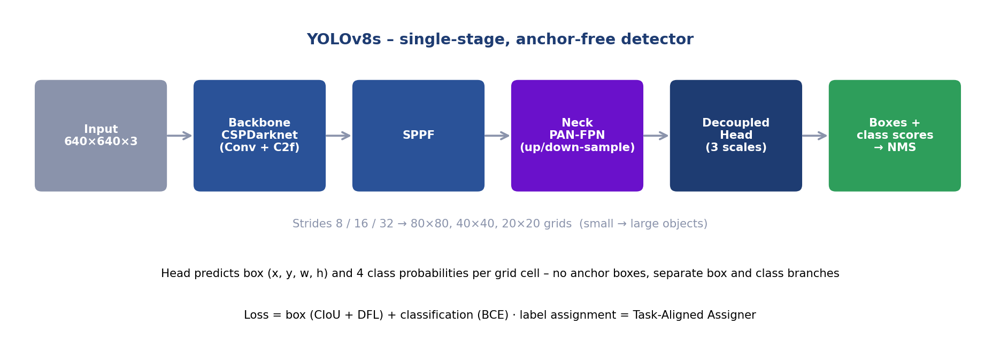{width=95%}

Single-stage, **anchor-free** detector with a **decoupled head**. One forward pass over a 640 × 640 image yields predictions at three scales.

| Scale | Stride | Grid (640 input) | Responsible for |
|---|---|---|---|
| P3 | 8 | 80 × 80 | Small objects |
| P4 | 16 | 40 × 40 | Medium |
| P5 | 32 | 20 × 20 | Large |

Total candidate predictions: 80² + 40² + 20² = **8,400** per image.

### 6.2 Components
- **Backbone** – CSPDarknet-style stack of Conv (+BN+SiLU) layers and **C2f** blocks (cross-stage partial with more gradient paths than YOLOv5's C3); ends with **SPPF** (fast spatial pyramid pooling) to enlarge the receptive field.
- **Neck** – **PAN-FPN**: a top-down path injects semantics into high-resolution maps, a bottom-up path pushes fine localisation back up.
- **Head** – decoupled: one branch regresses box distances, another predicts class scores; no objectness score.
- **Activation** – SiLU; **normalisation** – BatchNorm (fused into Conv at inference → "168 layers (fused)").

### 6.3 Box representation and decoding
For each grid cell the head predicts the distance from the cell centre to the four box sides (left, top, right, bottom). With **Distribution Focal Loss** each distance is predicted as a discrete probability distribution over `reg_max = 16` bins; the expected value of the distribution is the distance (in stride units). The distances are converted to `(x1, y1, x2, y2)` in pixels.

### 6.4 Loss function

Total loss (weighted sum, default gains `box = 7.5`, `cls = 0.5`, `dfl = 1.5`):

```
L = 7.5·L_box + 0.5·L_cls + 1.5·L_dfl
```

- **Classification loss** `L_cls` – binary cross-entropy per class on the class logits (multi-label style; no softmax).
- **Box loss** `L_box` – **CIoU**:
  `L_CIoU = 1 − IoU + ρ²(b, b_gt)/c² + α·v`
  where ρ is the distance between centres, c the diagonal of the smallest enclosing box, `v = (4/π²)(arctan(w_gt/h_gt) − arctan(w/h))²` penalises aspect-ratio mismatch and `α = v / ((1 − IoU) + v)`.
- **DFL** – for a target distance `y` between bins `y_i` and `y_{i+1}` with predicted probabilities `S_i, S_{i+1}`:
  `L_DFL = −[(y_{i+1} − y)·log S_i + (y − y_i)·log S_{i+1}]`
  It pushes probability mass to the two bins around the true value, giving sharper localisation of ambiguous edges.

### 6.5 Label assignment – Task-Aligned Assigner (TAL)
For each ground-truth box, candidate cells whose centres lie inside it are scored by an **alignment metric**
`t = s^α · u^β` (s = predicted score for the true class, u = IoU of the predicted box with the ground truth; Ultralytics uses α = 0.5, β = 6, top-k = 10).
The top-k cells become positives for that box; conflicts are resolved by the highest IoU. This couples classification confidence with localisation quality.

### 6.6 Inference post-processing
1. Take class scores (sigmoid) and decoded boxes for all 8,400 candidates.
2. Drop candidates with max class score < `conf` (τ).
3. **Non-maximum suppression** (per class): sort by score, keep the best, discard boxes with IoU > `iou` (default 0.7) against it, repeat.
4. Return at most `max_det` (300) boxes, scaled back to the input image coordinates.

### 6.7 Transfer learning
Initial weights `yolov8s.pt` were trained on **COCO** (80 classes). The classification head is re-initialised for 4 classes; everything else starts from COCO values and is fine-tuned end-to-end.

### 6.8 Why this model (summary)
Single-stage speed, anchor-free simplicity (good for odd-shaped cracks), multi-scale neck, COCO weights, complete tool-chain, and the small variant's sweet-spot compute.

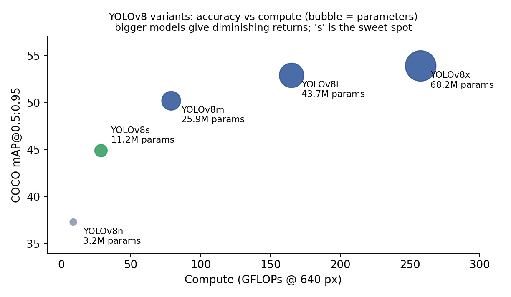{width=65%}

| Variant | Params (M) | GFLOPs | COCO mAP50-95 |
|---|---|---|---|
| n | 3.2 | 8.7 | 37.3 |
| **s** | **11.2** | **28.6** | **44.9** |
| m | 25.9 | 78.9 | 50.2 |
| l | 43.7 | 165.2 | 52.9 |
| x | 68.2 | 257.8 | 53.9 |

---

## 7. Training reference

### 7.1 Command used

```python
from ultralytics import YOLO
model = YOLO('yolov8s.pt')
model.train(data='…/rdd_India.yaml', epochs=100, warmup_epochs=5, batch=32,
            imgsz=640, save_period=10, workers=1, project='runs/RDD_India',
            name='Baseline_YOLOv8Small_Filtered', seed=1337, cos_lr=True, mosaic=0.0)
```

### 7.2 Hyper-parameter reference (what each means)

| Parameter | Value used | Default (v8.0.201) | Meaning / effect |
|---|---|---|---|
| `epochs` | 100 | 100 | Passes over the training set |
| `warmup_epochs` | 5 | 3 | Epochs of LR/momentum ramp-up |
| `batch` | 32 | 16 | Images per weight update |
| `imgsz` | 640 | 640 | Training/inference resolution |
| `cos_lr` | True | False | Cosine learning-rate decay instead of linear |
| `mosaic` | **0.0** | 1.0 | Probability of 4-image mosaic augmentation |
| `seed` | 1337 | 0 | Random seed |
| `save_period` | 10 | −1 | Save a checkpoint every N epochs |
| `workers` | 1 | 8 | Data-loader worker processes |
| `lr0`, `lrf` | default | 0.01, 0.01 | Initial LR; final LR = lr0·lrf |
| `momentum`, `weight_decay` | default | 0.937, 0.0005 | Optimiser momentum; L2 regularisation |
| `optimizer` | default `auto` | auto | Chooses SGD (long runs) or AdamW (short runs) from the iteration count |
| `patience` | default | 50 | Early-stop if no fitness gain for 50 epochs |
| HSV / scale / translate / flip | default | h .015, s .7, v .4 / .5 / .1 / lr-flip .5 | Online augmentation |

> Confirm the exact optimiser and values for *your* run in `runs/…/args.yaml`.

### 7.3 Learning-rate schedule
`warm-up` (epochs 0–4: LR rises from ≈ 0 to `lr0`, momentum from 0.8 → 0.937) → **cosine decay** from `lr0` to `lr0·lrf` over the remaining epochs.

### 7.4 Training outputs (inside `runs/<project>/<name>/`)

| File | Content |
|---|---|
| `weights/best.pt` | Checkpoint with the best fitness (0.1·mAP50 + 0.9·mAP50-95) |
| `weights/last.pt` | Most recent epoch (used for `resume=True`) |
| `weights/epochN.pt` | Every `save_period` epochs |
| `results.csv`, `results.png` | Per-epoch losses and metrics, plotted |
| `confusion_matrix.png`, `PR_curve.png`, `F1_curve.png`, `P_curve.png`, `R_curve.png` | Final evaluation plots |
| `labels.jpg`, `train_batch*.jpg`, `val_batch*_labels.jpg`, `val_batch*_pred.jpg` | Dataset statistics and visual checks |
| `args.yaml` | Every hyper-parameter used |

### 7.5 What to watch in `results.png`
- `train/box_loss`, `train/cls_loss`, `train/dfl_loss` should fall steadily.
- `val/*_loss` should fall then flatten; **rising val loss while train loss falls = overfitting**.
- `metrics/mAP50(B)` and `mAP50-95(B)` should rise and plateau.

### 7.6 Resuming
```python
YOLO('runs/RDD_India/<name>/weights/last.pt').train(resume=True)
```

### 7.7 Resource notes
RTX 2060 (6 GB): batch 32 at 640 px fits; if you see CUDA out-of-memory reduce `batch` to 16 or `imgsz` to 512. CPU-only training is possible but impractical.

---

## 8. Evaluation in depth

### 8.1 Definitions (detection version)

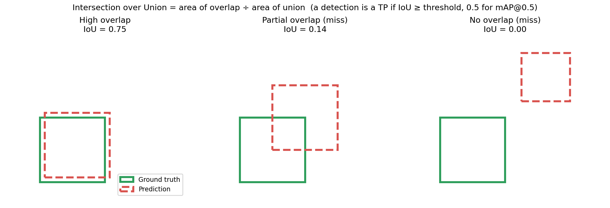{width=90%}

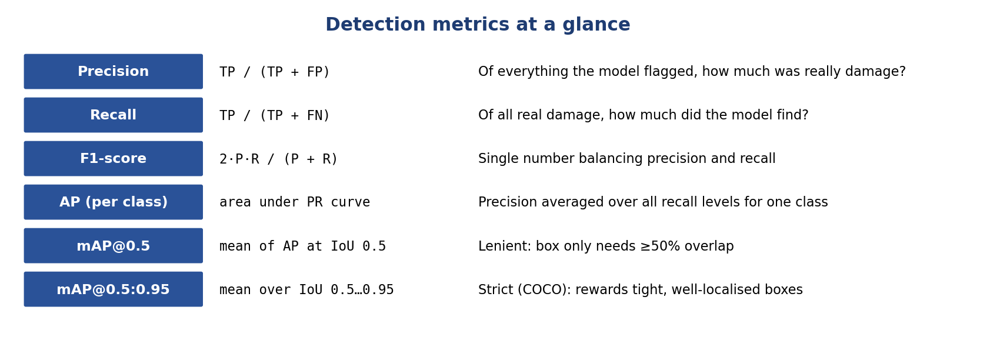{width=90%}

- **Match rule:** a prediction is a **TP** if its class equals the ground truth's and IoU ≥ threshold, and that ground truth isn't already matched by a higher-scoring prediction; else **FP**. Unmatched ground truths are **FN**.
- Precision `P = TP/(TP+FP)`, Recall `R = TP/(TP+FN)`, `F1 = 2PR/(P+R)`.
- **AP** = area under the interpolated precision-recall curve (101-point interpolation in Ultralytics/COCO style); **mAP** = mean AP across classes; **mAP50-95** additionally averages over IoU thresholds 0.50, 0.55, …, 0.95.

### 8.2 Worked example (toy, 1 class, IoU ≥ 0.5)
Predictions sorted by confidence, with 4 ground-truth objects in total:

| Rank | Conf | Matches a GT? | Cumulative TP | Cumulative FP | Precision | Recall |
|---|---|---|---|---|---|---|
| 1 | 0.95 | yes | 1 | 0 | 1.00 | 0.25 |
| 2 | 0.90 | yes | 2 | 0 | 1.00 | 0.50 |
| 3 | 0.80 | no | 2 | 1 | 0.67 | 0.50 |
| 4 | 0.70 | yes | 3 | 1 | 0.75 | 0.75 |
| 5 | 0.40 | no | 3 | 2 | 0.60 | 0.75 |

Make precision monotonically non-increasing from the right (interpolation) and integrate over recall: AP ≈ 0.25·1.00 + 0.25·1.00 + 0.25·0.75 + 0.25·0 (recall 0.75–1.0 never reached) ≈ **0.69**. The detector never finds the fourth object, which caps recall at 0.75.

### 8.3 Results table (validation set)

| Class | Inst. | P | R | F1 | mAP50 | mAP50-95 |
|---|---|---|---|---|---|---|
| Longitudinal Crack | 555 | 0.573 | 0.471 | 0.517 | 0.501 | 0.235 |
| Transverse Crack | 371 | 0.522 | 0.433 | 0.473 | 0.454 | 0.177 |
| Alligator Crack | 848 | 0.659 | 0.684 | 0.671 | 0.709 | 0.373 |
| Pothole | 498 | 0.584 | 0.503 | 0.540 | 0.524 | 0.229 |
| **All** | 2,272 | 0.584 | 0.523 | 0.552 | 0.547 | 0.254 |

P and R are reported at the confidence that maximises F1 across classes (Ultralytics' convention); F1 is derived as 2PR/(P+R).

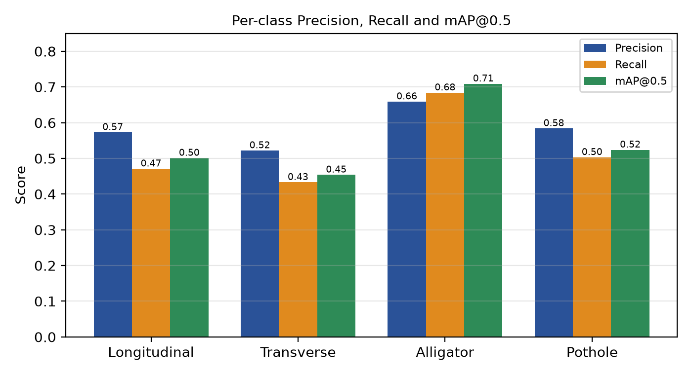{width=65%}

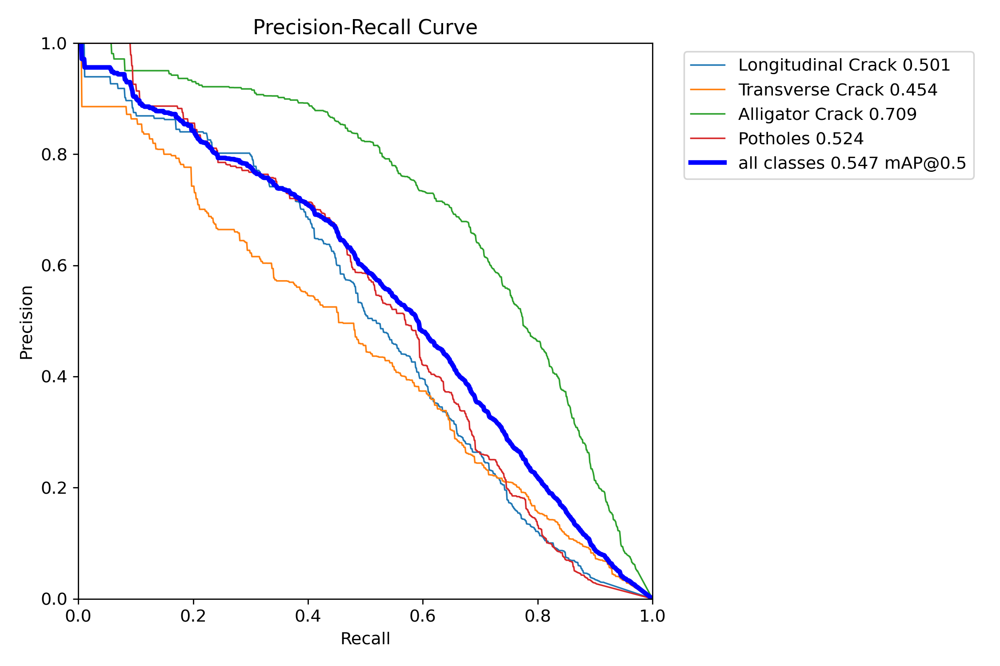{width=60%}

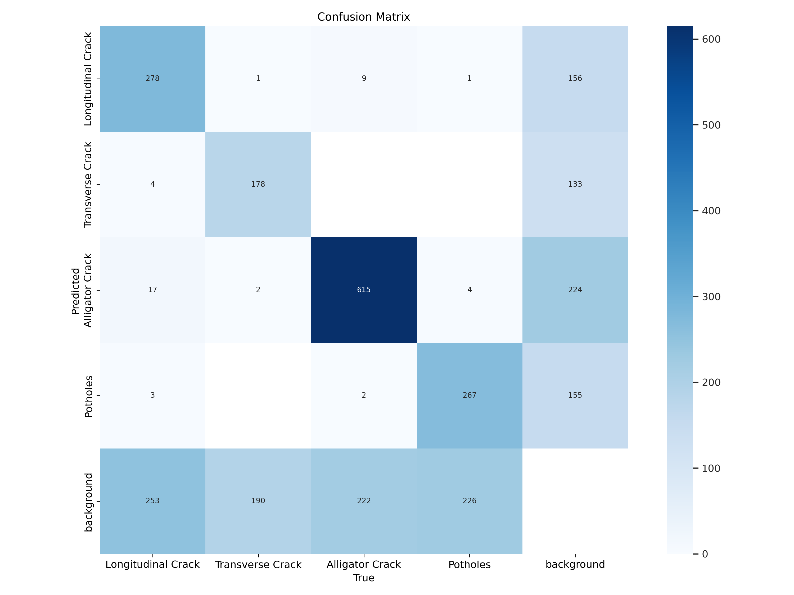{width=60%}

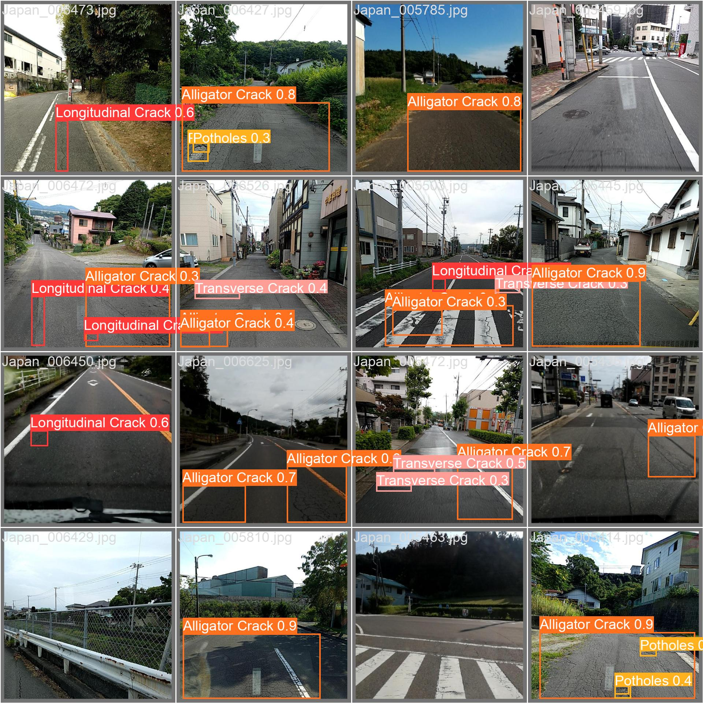{width=70%}

### 8.4 Error analysis (from the confusion matrix in the report)
| Error type | Evidence | Interpretation |
|---|---|---|
| Missed damage (FN) | 253 / 190 / 222 / 226 instances of the four classes predicted as background | Main error: faint or thin damage below the confidence cut |
| False alarms (FP) | 133–224 background boxes per class | Shadows, joints, patches, markings, wet patches |
| Class confusion | e.g. 9 longitudinal→alligator, 17 alligator→longitudinal | Rare; the classifier separates types well when it sees damage |
| Best class | Alligator (615 correct) | Large, textured, frequent |
| Worst class | Transverse | Thin, short, rare |

### 8.5 Choosing an operating point
Lower τ → more recall, more false alarms. For screening use τ ≈ 0.25; for report-quality overlays use τ ≈ 0.5. To pick τ rigorously, read the **F1-vs-confidence** curve (`F1_curve.png`) and choose the peak.

### 8.6 Speed
`Speed: 0.7 ms preprocess, 9.3 ms inference, 0.0 ms loss, 3.4 ms postprocess per image` on RTX 2060. On the cloud CPU the app log shows `2.0 ms preprocess, 161.0 ms inference, 1.1 ms postprocess` for a 640 × 640 input.

---

## 9. Application internals

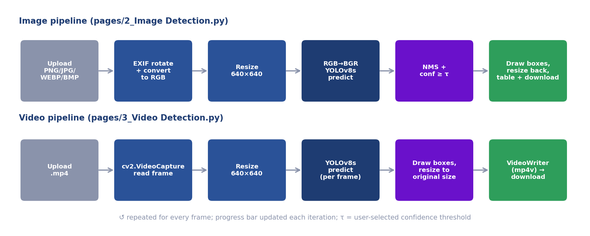{width=95%}

### 9.1 Streamlit execution model (important)
Streamlit re-executes the whole page script whenever a widget changes. Therefore:
- The model is stored in `st.session_state["yolov8smallrdd"]` and reused.
- Heavy work is placed behind conditions (`if image_file is not None`, `if st.button(...)`).
- Multi-page apps are formed from `Home.py` + files in `pages/` (sidebar order follows the numeric prefix).

### 9.2 `pages/2_Image Detection.py`
| Step | Code idea | Why |
|---|---|---|
| Ensure weights | `download_file(MODEL_URL, MODEL_LOCAL_PATH, expected_size=89569358)` | Re-download if missing/corrupt (size check) |
| Load model once | `st.session_state` cache → `YOLO(MODEL_LOCAL_PATH)` | Avoid reload per interaction |
| Upload | `st.file_uploader(type=[png, jpg, jpeg, webp, bmp])` | Accepted formats |
| Threshold | `st.slider(0.0–1.0, default 0.25, step 0.05)` | Precision/recall control |
| Normalise | `ImageOps.exif_transpose` → `convert("RGB")` | Orientation and channel fixes |
| Resize | `cv2.resize((640, 640), INTER_AREA)` | Match training size |
| Predict | `net.predict(cv2.cvtColor(img, RGB2BGR), conf=τ)` | Ultralytics expects BGR |
| Annotate | `results[0].plot()` (BGR) → `RGB` → resize to original | Draw, then restore user size |
| Report | `st.success` + `st.table` (class, confidence %), or `st.warning` if empty | Transparent output |
| Download | PNG bytes via `BytesIO` → `st.download_button` | Save result |

`Detection(NamedTuple)` holds `class_id, label, score, box` per detection; `CLASSES = ["Longitudinal Crack","Transverse Crack","Alligator Crack","Potholes"]` maps ids to names (must match the YAML order).

### 9.3 `pages/3_Video Detection.py`
| Step | Detail |
|---|---|
| State | `st.session_state.runningInference` disables the uploader/slider/button during processing |
| Save upload | `write_bytesio_to_file("./temp/video_input.mp4", file)` |
| Metadata | `cv2.VideoCapture` → width, height, FPS, frame count → duration `mm:ss` |
| Writer | `cv2.VideoWriter(temp_file_infer, fourcc('mp4v'), fps, (w, h))` |
| Loop | read frame → `cvtColor(BGR2RGB)` → resize 640×640 → `predict(conf=τ)` → `plot()` → resize to (w, h) → `cvtColor(RGB2BGR)` → `write` → `st.image` live preview → progress bar |
| Finish | `st.success`, download button (`video/mp4`), "Restart Apps" (`st.rerun()`) |
| Default τ | 0.5 |

> Known issue: the RGB frame is passed to `predict`, which assumes BGR (see §15).

### 9.4 `Home.py`
Pure presentation: HTML/CSS via `st.markdown(..., unsafe_allow_html=True)` for the hero banner, feature cards, class chips, team avatars and link placeholders.

### 9.5 `.streamlit/config.toml`
```toml
[server]
maxUploadSize = 1000   # MB – the file-uploader limit
[theme]
base = "light"
```

### 9.6 Files and storage
- Weights: `models/YOLOv8_Small_RDD.pt` (committed, 85 MB – under GitHub's 100 MB limit).
- Temp: `./temp/video_input.mp4`, `./temp/video_infer.mp4` – **fixed names**, overwritten on each run, not cleaned automatically (git-ignored).

---

## 10. Using the model from code / CLI

### 10.1 Python
```python
from ultralytics import YOLO
model = YOLO("models/YOLOv8_Small_RDD.pt")
res = model.predict("road.jpg", conf=0.25, imgsz=640)[0]   # path input → letterboxed automatically
for b in res.boxes:
    print(model.names[int(b.cls)], float(b.conf), b.xyxy[0].tolist())
res.save("annotated.jpg")        # writes the annotated image
```

### 10.2 Video / webcam / folder
```python
model.predict("road.mp4", conf=0.4, save=True)           # annotated video in runs/detect/predict
model.track("road.mp4", tracker="bytetrack.yaml", persist=True)   # adds persistent IDs
```

### 10.3 CLI
```bash
yolo detect predict model=models/YOLOv8_Small_RDD.pt source=road.jpg conf=0.25
yolo detect val model=models/YOLOv8_Small_RDD.pt data=training/dataset/rddIndiaFiltered/rdd_India.yaml
yolo export model=models/YOLOv8_Small_RDD.pt format=onnx      # also tflite, engine, coreml
```

### 10.4 Input conventions (important)
| Input type | Colour order assumed by Ultralytics |
|---|---|
| File path / URL | Handled correctly (decoded internally) |
| `PIL.Image` | RGB |
| `numpy.ndarray` | **BGR** (OpenCV convention) |

---

## 11. Deployment and operations

### 11.1 Streamlit Community Cloud – step by step
1. Push the repo (public) to GitHub.
2. https://share.streamlit.io → **Create app → from GitHub**.
3. Repository `Harshitjhamb/RoadSense_AI`, branch `main`, main file `Home.py`.
4. **Advanced settings → Python 3.11**.
5. Deploy. The platform clones the repo, installs `packages.txt` (apt) then `requirements.txt` (pip), provisions a container and starts Streamlit. Pushing to `main` redeploys automatically.

Live URL: **https://roadsenseai01.streamlit.app/**

### 11.2 Environment facts
- OS image: Debian (trixie at the time of deployment), CPU-only, ~1 GB RAM, shared CPU.
- Apps sleep after inactivity and wake on the next visit.
- Resource governance: heavy apps are **CPU-throttled** (message: "we've temporarily reduced its CPU … throttle will expire at …").

### 11.3 Troubleshooting matrix

| Symptom / log line | Root cause | Resolution |
|---|---|---|
| `E: Package 'libgl1-mesa-glx' has no installation candidate` | Package removed in Debian trixie | `packages.txt` → `libgl1`, `libglib2.0-0` |
| `ImportError: libGL.so.1: cannot open shared object file` | Missing system lib for OpenCV | Add `libgl1` to `packages.txt` |
| `ImportError: libgthread-2.0.so.0` | Missing glib | Add `libglib2.0-0` |
| `av==10.0.0` build error (ffmpeg headers / `pkg-config`) | No wheel for Python ≥ 3.11 → source build | Use `av==12.3.0` or newer |
| `Could not find a version that satisfies the requirement torch==…` | Wrong index / Python version | Keep the CPU `--extra-index-url`; use Python 3.10/3.11 |
| `streamlit 1.28.0 requires rich<14` (pip warning) | Transitive `rich 15` | Ignore, or pin `rich<14` |
| App slow / "reduced its CPU" banner | Fair-use throttle | Wait; reduce frames/size; move to Hugging Face Spaces / GPU host |
| App crashes / restarts on large video | Memory (≈1 GB) or timeout | Shorter video, lower resolution, frame skipping, bigger host |
| Weights download loop | File size ≠ `expected_size` | Ensure the committed `.pt` is exactly 89,569,358 bytes (or update the constant) |
| `st.image` shows wrong colours | RGB/BGR mix-up | Keep conversions consistent (see §9) |
| Uploaded phone photo detects nothing | Sideways image | Ensure `exif_transpose` is applied |
| Output video won't play in browser | `mp4v` codec | Download and play locally, or re-encode with ffmpeg `-c:v libx264` |
| `CUDA` not found on the cloud | CPU-only host | Expected; the CPU wheel is used |

### 11.4 Alternative hosting
| Option | Pros | Cons |
|---|---|---|
| Hugging Face Spaces (Streamlit/Docker) | Free tier with more RAM (≈16 GB) | Public by default, queueing |
| Docker on a VM / Cloud Run / Render | Full control | Cost, ops |
| GPU instance (EC2/GCP) | Real-time video | Cost |
| Edge (Jetson/phone) | Offline, low latency | Export + optimisation work |

### 11.5 Minimal Dockerfile (if you move off Streamlit Cloud)
```dockerfile
FROM python:3.11-slim
RUN apt-get update && apt-get install -y --no-install-recommends libgl1 libglib2.0-0 && rm -rf /var/lib/apt/lists/*
WORKDIR /app
COPY requirements.txt .
RUN pip install --no-cache-dir -r requirements.txt
COPY . .
EXPOSE 8501
CMD ["streamlit", "run", "Home.py", "--server.port=8501", "--server.address=0.0.0.0"]
```

### 11.6 Operational hygiene
- Don't commit the raw dataset or `runs/` (large; ignored).
- Keep weights < 100 MB for plain GitHub, otherwise use Git LFS or Releases.
- Periodically clean `./temp/` on long-running hosts.
- Pin versions; upgrade deliberately and re-run a smoke test (§14).

---

## 12. Reproducibility checklist

- [ ] Python 3.10/3.11 environment; `pip install -r requirements.txt`
- [ ] Download RDD2022; keep the **India** folder
- [ ] Edit notebook paths; run `0_Prepare…` (seed 1337 → identical split)
- [ ] Confirm the dataset YAML paths resolve
- [ ] `1_Training…` with the exact arguments in §7.1; archive `args.yaml`, `results.csv`
- [ ] `2_Evaluation…` on the val split; compare against §8.3
- [ ] Save the final `best.pt` → `models/`; update `expected_size` in the two pages if the file size changes
- [ ] Record: GPU model, driver/CUDA, library versions, training time, git commit

Sources of non-determinism: GPU kernels (cuDNN), data-loader worker order, library version drift.

---

## 13. How-to guides (extending the project)

### 13.1 Fix the video page colour order (recommended)
In `pages/3_Video Detection.py`, remove the BGR→RGB conversion before inference and do the display conversion only for `st.image`:
```python
ret, frame = videoCapture.read()                         # BGR
results = net.predict(frame, conf=score_threshold, imgsz=640)   # BGR in, letterboxed
annotated_bgr = results[0].plot()                       # BGR out, original size
cv2writer.write(annotated_bgr)                          # BGR for VideoWriter
imageLocation.image(cv2.cvtColor(annotated_bgr, cv2.COLOR_BGR2RGB))
```
This also removes the aspect-ratio squashing (Ultralytics letterboxes) and an extra resize.

### 13.2 Speed up CPU video processing
- Process every *N*th frame (reuse the previous annotation for skipped frames), or
- Resize input to `imgsz=416/480` (re-evaluate accuracy), or
- Export to ONNX/OpenVINO and run with `onnxruntime`, or
- Cap upload length/size.

### 13.3 Use unique temp files (multi-user safe)
```python
import tempfile, os
tmp_in = tempfile.NamedTemporaryFile(delete=False, suffix=".mp4").name
tmp_out = tempfile.NamedTemporaryFile(delete=False, suffix=".mp4").name
# … process … then os.remove(tmp_in); os.remove(tmp_out)
```

### 13.4 Share one model across sessions
```python
@st.cache_resource
def load_model(path): return YOLO(path)
net = load_model(str(MODEL_LOCAL_PATH))
```

### 13.5 Add object tracking and counting
Use `model.track(source, tracker="bytetrack.yaml", persist=True)`; count unique `box.id` values per class to report "N potholes in this clip".

### 13.6 Add a new damage class
1. Add the code to the conversion filter/mapping (class id 4, update `if class_list[i] < 4` → `< 5`).
2. Extend `names:` in the YAML and `CLASSES` in both app pages.
3. Re-run split, **retrain** (the head size changes), re-evaluate, update docs.

### 13.7 Try a bigger model / higher resolution
`YOLO('yolov8m.pt').train(..., imgsz=960, batch=8)` (reduce batch to fit memory); compare mAP per class and speed; keep the same seed and split for a fair comparison.

### 13.8 Handle class imbalance
Oversample transverse-crack images, tune the `cls` loss gain, collect more examples, or add targeted augmentations (small rotations, brightness, blur).

### 13.9 Add GPS + map output (sketch)
Read GPS from image EXIF (`PIL.ExifTags`) or the video's telemetry; store `(lat, lon, class, conf)` per detection; plot with `pydeck`/`folium`; aggregate by road segment.

### 13.10 Enable realtime webcam
`streamlit-webrtc` + `VideoProcessorBase` with a callback that runs `predict` on each frame; supply ICE/TURN servers (STUN alone fails on many cloud networks); expect to need a GPU or a nano model for smooth FPS.

### 13.11 Export for mobile / edge
`model.export(format="tflite", int8=True)` / `"onnx"` / `"engine"` (TensorRT) / `"coreml"`; validate accuracy after quantisation.

---

## 14. Test plan

| # | Test | Input | Expected |
|---|---|---|---|
| 1 | Smoke | Open the app | Home renders; sidebar shows 3 pages |
| 2 | Image – JPG | Road photo with obvious potholes | Boxes + table; PNG downloads |
| 3 | Image – PNG with alpha | RGBA PNG | No crash; processed as RGB |
| 4 | Image – grayscale | 1-channel JPG | No crash |
| 5 | Image – rotated phone photo (EXIF) | Portrait photo | Detection on upright image |
| 6 | Image – clean road | No damage | Warning message; output = original |
| 7 | Threshold slider | 0.05 vs 0.8 on the same image | More boxes at low τ, fewer at high τ |
| 8 | Large image | 4000 × 3000 | Works (resized internally); output resized back |
| 9 | Video – short mp4 | 10–20 s clip | Progress bar → success → downloadable output |
| 10 | Video – wrong type | `.avi` | Rejected by uploader |
| 11 | Video – corrupt | Broken mp4 | "Error opening the video file" |
| 12 | Weights missing | Delete `models/*.pt` locally | Auto-download with progress bar |
| 13 | Model regression | `yolo val` | mAP50 ≈ 0.547 on the saved val split |
| 14 | Realtime page | Open | "Coming soon" message |
| 15 | Concurrency (known risk) | Two users upload videos at once | May collide on temp files – see §13.3 |

---

## 15. Provenance, known issues and limitations

### 15.1 Provenance – verify and state accurately
1. **Weights.** `models/YOLOv8_Small_RDD.pt` is the baseline weight file of the upstream project [oracl4/RoadDamageDetection](https://github.com/oracl4/RoadDamageDetection); the app downloads it from that repository if absent. Claim only what the team actually did (re-running / evaluating / extending) unless you hold your own training logs.
2. **Which countries were the weights trained on?** `.gitignore` still lists a dataset folder named `rddJapanIndiaFiltered` and the preparation notebook's saved output shows both **Japan** and **India** being copied, which suggests the *upstream* run used Japan + India. Our documentation describes an **India-only** protocol (config `rdd_India.yaml`). If asked, say precisely which weights were trained on what; if the shipped weights came from the Japan + India run, say so, and report the India-validation result as an *evaluation on Indian roads*.
3. **Split sizes.** The prep notebook's saved output (India: 3,594 train / 399 val) is from a different run than the evaluation (1,294 val images, 2,272 instances). Quote the evaluation numbers for results.

### 15.2 Known issues

| Area | Issue | Impact | Fix |
|---|---|---|---|
| Video page | RGB frames passed to a BGR-expecting model | Small accuracy loss | §13.1 |
| Both pages | Square 640 × 640 resize without letterbox | Slight distortion of wide images | §13.1 |
| Video page | Fixed temp file names | Collisions with concurrent users | §13.3 |
| Both pages | Model cached in `session_state` (per session) | Extra memory per user | §13.4 |
| Video page | `mp4v` output | May not play inline in browsers | Re-encode to H.264 |
| Video page | Different default τ (0.5) than Image (0.25) | Inconsistent UX | Align or pick via F1 curve |
| Hosting | CPU throttling, ~1 GB RAM | Slow/unstable on long videos | Alternative host; frame skipping |
| Home page | "GitHub / Documentation / Report" pills say "Coming soon" | Cosmetic | Add real links |

### 15.3 Limitations of the study
- No independent test set; random split may leak near-duplicates.
- Domain limited to Indian smartphone imagery; not tested at night, in heavy rain or with motion blur.
- Boxes only (no severity, depth or area); no GPS; no tracking in video.
- Moderate accuracy on thin cracks (mAP@0.5 0.45–0.50).

---

## 16. Glossary

| Term | Meaning |
|---|---|
| **Alligator crack** | Network of interconnected cracks (fatigue failure) resembling alligator skin |
| **Anchor box** | Predefined box shape used by older detectors as regression reference |
| **Anchor-free** | Predicts boxes directly from grid locations, no anchors |
| **AP / mAP** | Average Precision (area under PR curve) / mean over classes |
| **Augmentation** | Random label-preserving transformations of training data |
| **Background image** | Image with no labelled objects (negative sample) |
| **Backbone / Neck / Head** | Feature extractor / multi-scale fusion / prediction layers |
| **Batch size** | Samples per optimisation step |
| **BCE** | Binary cross-entropy loss |
| **BGR / RGB** | Channel orders (OpenCV/Ultralytics numpy = BGR; PIL/display = RGB) |
| **Bounding box** | Rectangle localising an object |
| **C2f** | YOLOv8's cross-stage partial block with two-path feature flow |
| **Checkpoint** | Saved model weights at some training point |
| **CIoU** | Complete-IoU box loss (overlap + centre distance + aspect ratio) |
| **COCO** | Large generic detection dataset (80 classes) used for pre-training |
| **Confidence (score)** | Model's estimated probability that a detection is correct for its class |
| **Confusion matrix** | Table of predicted vs true classes (+ background) |
| **CRDDC2022** | Crowdsensing-based Road Damage Detection Challenge 2022 |
| **Data leakage** | Validation information present in training, inflating scores |
| **DFL** | Distribution Focal Loss for box-edge regression |
| **Domain shift** | Train/deploy data distribution mismatch |
| **EXIF** | Image metadata (orientation, GPS, camera) |
| **Epoch / iteration** | Full pass over data / one weight update |
| **F1** | Harmonic mean of precision and recall |
| **FLOPs / GFLOPs** | Floating-point operations (compute cost) |
| **FN / FP / TP / TN** | False negative / false positive / true positive / true negative |
| **Fine-tuning** | Continuing training of a pre-trained model on new data |
| **IoU** | Intersection over Union of two boxes |
| **Letterbox** | Resize preserving aspect ratio and pad to a square |
| **Longitudinal / Transverse crack** | Crack along / across the direction of travel |
| **Mosaic** | Augmentation stitching four images |
| **NMS** | Non-maximum suppression – removes duplicate overlapping boxes |
| **Normalisation** | Scaling values (coordinates/pixels) to a standard range (0–1) |
| **Overfitting / underfitting** | Memorising training data / failing to learn it |
| **PAN-FPN** | Path-aggregation feature pyramid network (neck) |
| **Pascal VOC** | XML annotation format with pixel-corner boxes |
| **Precision / Recall** | Share of detections that are right / share of real objects found |
| **PR curve** | Precision as a function of recall across thresholds |
| **RDD2022** | Road Damage Dataset 2022 |
| **SiLU** | Smooth activation function x·sigmoid(x) |
| **SPPF** | Spatial Pyramid Pooling – Fast |
| **STUN / TURN** | Protocols that help WebRTC traverse NATs (TURN relays traffic) |
| **Stride** | Down-sampling factor between input and a feature map |
| **TAL** | Task-Aligned Assigner for positive-sample selection |
| **Transfer learning** | Re-using weights learned on another task |
| **Validation set** | Held-out data for monitoring/evaluation during development |
| **Warm-up** | Gradual LR increase at the start of training |
| **YOLO** | "You Only Look Once" single-pass detector family |

---

## 17. References

1. D. Arya, H. Maeda, S. K. Ghosh, D. Toshniwal, Y. Sekimoto, "RDD2022: A multi-national image dataset for automatic road damage detection," arXiv:2209.08538, 2022. Data: github.com/sekilab/RoadDamageDetector
2. D. Arya et al., "Crowdsensing-based Road Damage Detection Challenge (CRDDC'2022)," IEEE Big Data, 2022.
3. G. Jocher, A. Chaurasia, J. Qiu, "Ultralytics YOLOv8," 2023 – docs.ultralytics.com
4. J. Redmon, S. Divvala, R. Girshick, A. Farhadi, "You Only Look Once," CVPR 2016.
5. T.-Y. Lin et al., "Microsoft COCO: Common Objects in Context," ECCV 2014.
6. Z. Zheng et al., "Distance-IoU Loss: Faster and Better Learning for Bounding Box Regression" (CIoU), AAAI 2020.
7. X. Li et al., "Generalized Focal Loss" (DFL), NeurIPS 2020.
8. C. Feng et al., "TOOD: Task-aligned One-stage Object Detection" (TAL), ICCV 2021.
9. A. Paszke et al., "PyTorch," NeurIPS 2019.
10. oracl4, "RoadDamageDetection" – github.com/oracl4/RoadDamageDetection
11. Streamlit documentation – docs.streamlit.io · OpenCV – opencv.org
