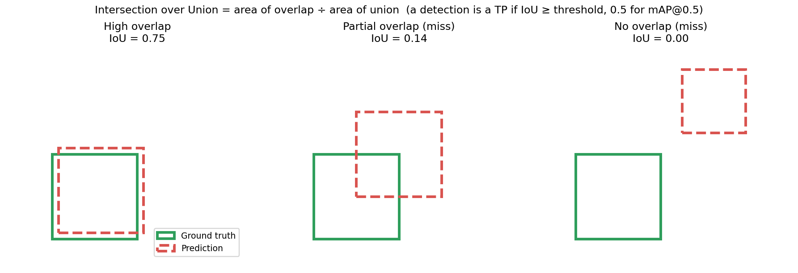
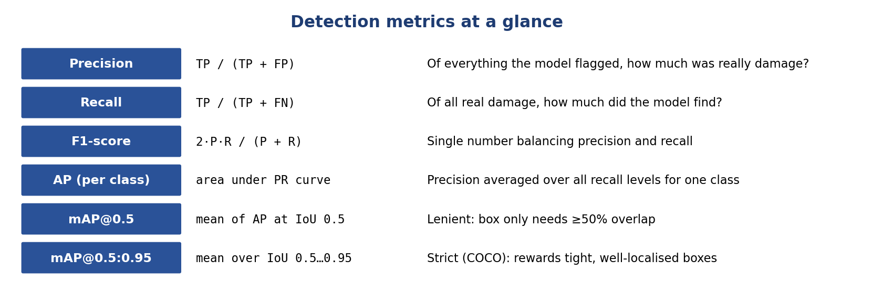
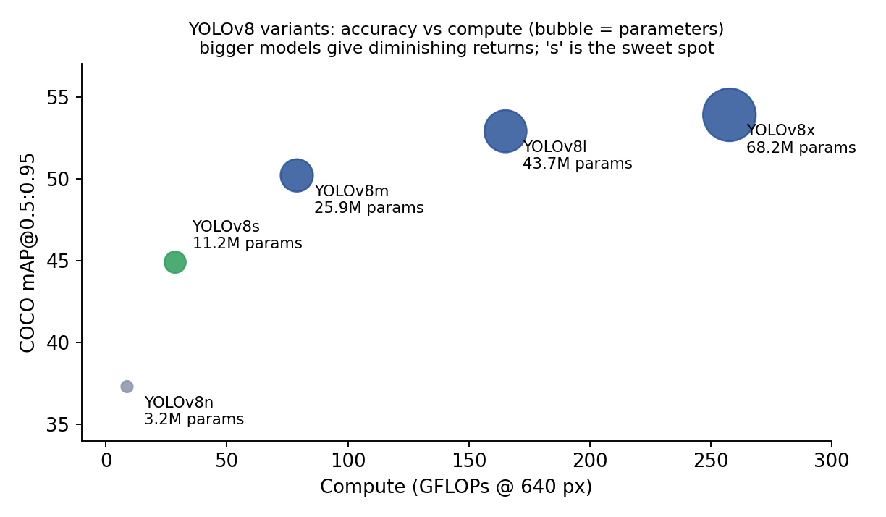
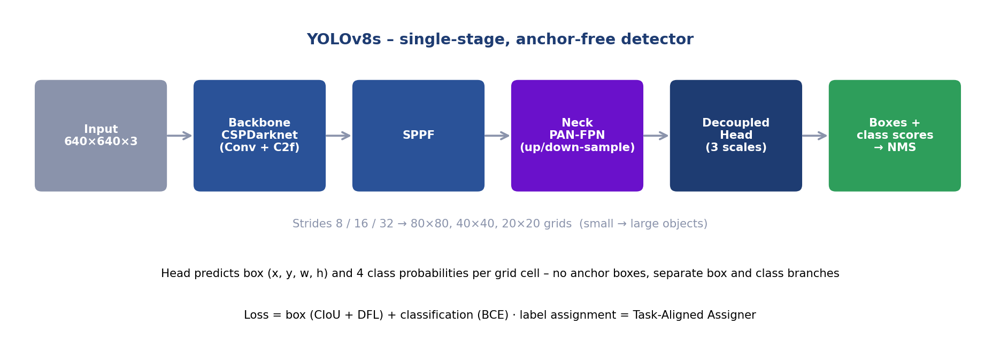
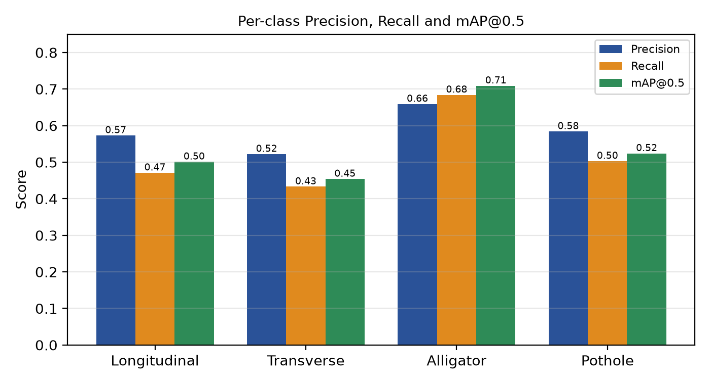
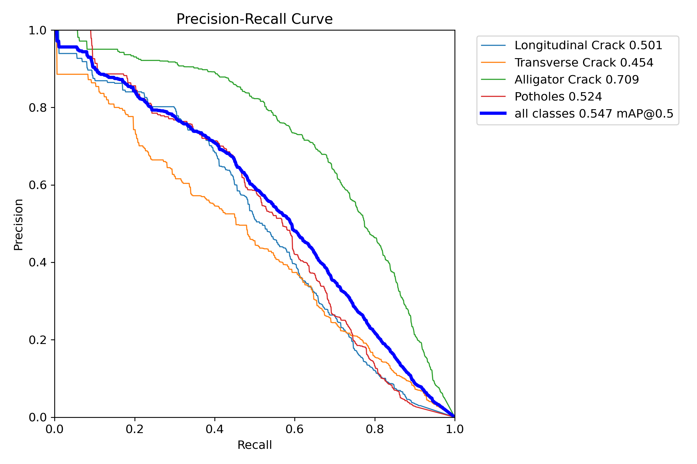
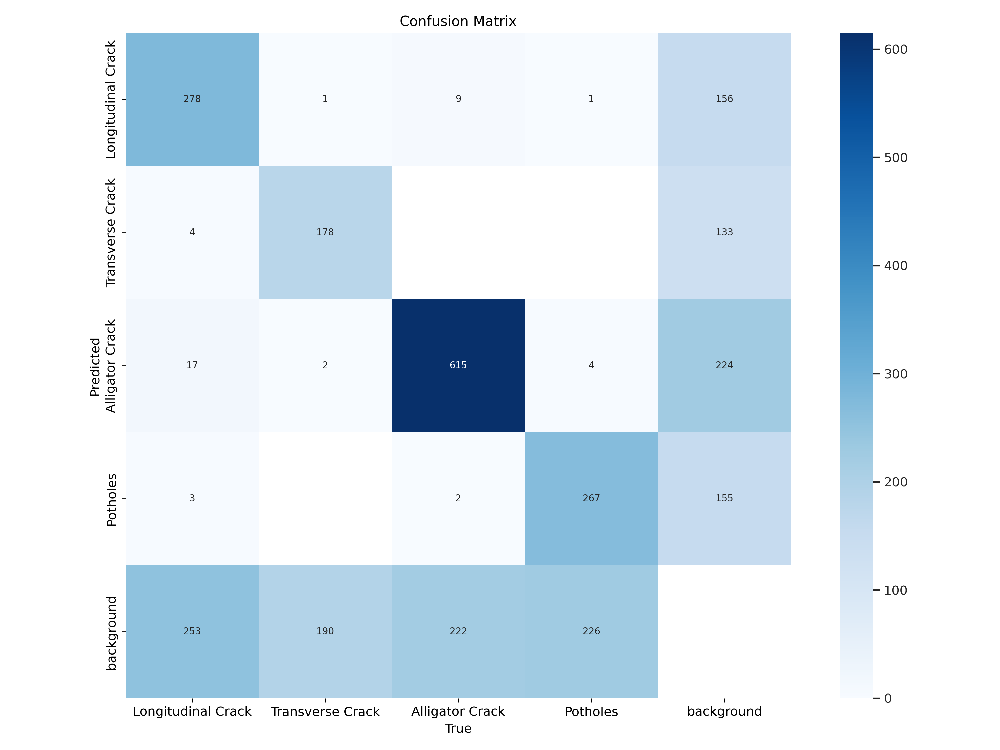
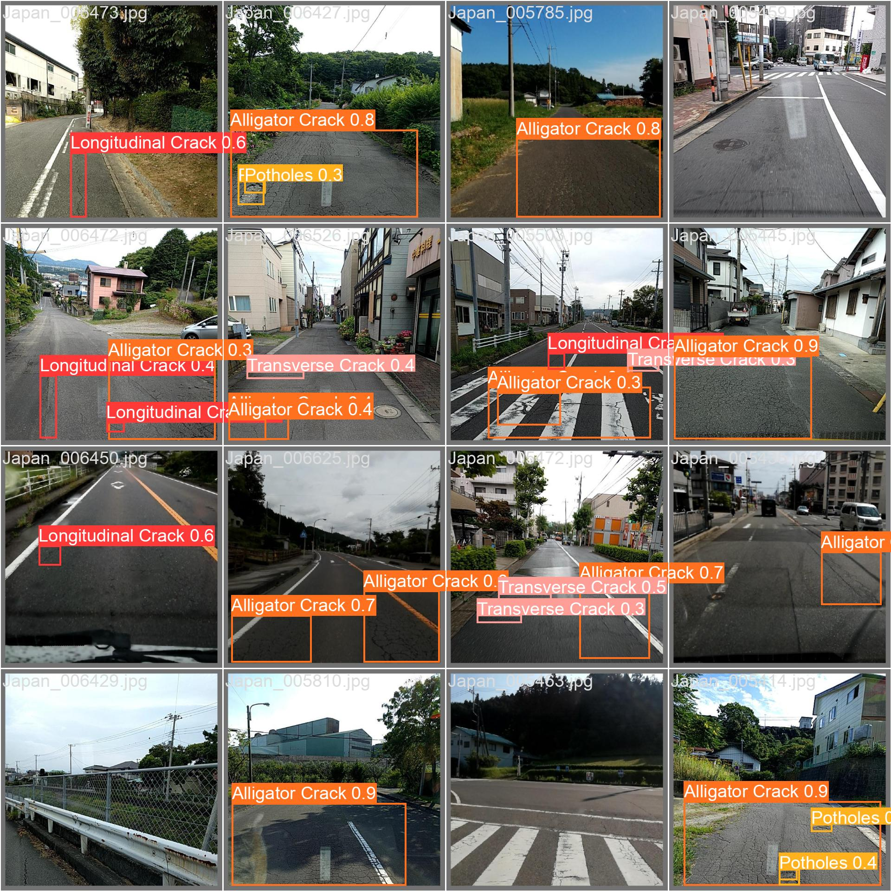

# RoadSense AI – Concepts and Interview / Viva Questions (revision sheet)

Everything that can be asked about this project, in one file:
**A** facts to verify with your team · **B** data & ML concepts · **C** model choice · **D** results to quote · **E** 85 questions with answers · **F** glossary.

---

## A. Verify these first

> 
> These are things a careful examiner could probe. Settle them as a team and keep your answers consistent.
> 1. **Weights provenance.** `models/YOLOv8_Small_RDD.pt` is the baseline weight file of the upstream open-source project [oracl4/RoadDamageDetection](https://github.com/oracl4/RoadDamageDetection) (the app even downloads it from that URL if the file is missing). Our contribution, as stated in this README, is to *study, re-run, evaluate and extend* that protocol on the India subset and to build the app. Do **not** claim to have trained those exact weights from scratch unless the team really did (the training run logs / `args.yaml` would prove it).
> 2. **Split sizes.** The saved output cells of `training/0_PrepareDatasetYOLOv8.ipynb` print `3594 / 399` (train / val) for India, while the evaluation run (`2_EvaluationTesting.ipynb`) validates on **1,294 images / 2,272 instances**. Those outputs come from different runs. Quote the evaluation figures (1,294 / 2,272) – they are the ones behind every result in this repo – and be ready to say the prep-notebook output is from an earlier run of the upstream notebook.
> 3. **Video page channel order.** `pages/3_Video Detection.py` converts frames BGR→RGB *before* `predict`, but Ultralytics expects BGR numpy arrays (the image page was fixed, the video page was not). The output video looks right, but the model sees colour-swapped frames, which can slightly hurt accuracy. See [limitations](#14-known-limitations-and-future-work).

> 4. **Japan + India vs India-only.** `.gitignore` and the prep-notebook output refer to a `rddJapanIndiaFiltered` dataset, so the upstream weights may have been trained on Japan + India. Be precise about what was trained on what (details in `02_DOCUMENTATION.md` §15.1).

---

## B. Data and ML concepts

Short, exam-ready definitions grouped by topic. (Every one of these is a possible question.)

### B.1 Data concepts
- **Supervised learning** – learning from labelled examples (image + boxes + classes).
- **Bounding box** – rectangle around an object; stored as corners (VOC) or centre/size (YOLO).
- **Annotation / label noise** – humans label thin cracks inconsistently; this caps the achievable accuracy.
- **Normalisation** – scaling coordinates to 0–1 (labels) and pixel values to 0–1 (images) so training is stable and resolution-independent.
- **Train / validation / test** – *train* fits the weights; *validation* tunes choices and monitors overfitting; *test* is touched once for the final unbiased number. We have no public test set, so the validation split doubles as our report set.
- **Data leakage** – information from validation leaking into training (e.g. near-duplicate frames) → over-optimistic scores.
- **Class imbalance** – unequal class frequencies; rare classes are learned worse. Remedies: more data, class weights, oversampling, focal loss, targeted augmentation.
- **Background / negative images** – images without objects; reduce false positives.
- **Data augmentation** – random label-preserving changes (flip, scale, translate, HSV colour jitter, mosaic) that enlarge the effective dataset and improve generalisation.
- **Mosaic augmentation** – stitches 4 training images into one. We **switched it off** (`mosaic=0.0`) because stitching cuts and rescales thin cracks and creates artificial borders that look like cracks.
- **Domain shift** – train and deployment data differ (country, camera, weather) → accuracy drops.
- **Transfer learning** – start from weights trained on a big dataset (COCO, 80 everyday classes) and fine-tune. Early layers already know edges/textures; we only adapt to roads. Faster, needs less data, usually more accurate.

### B.2 Model/training concepts
- **Epoch** – one full pass over the training set (we use 100). **Batch size** – images per weight update (32). **Iteration** – one update.
- **Learning rate (LR)** – step size of gradient descent. **Warm-up** – start with a tiny LR for the first 5 epochs so fresh heads don't destroy pre-trained features. **Cosine schedule** – LR decays smoothly like a half-cosine, so late training takes small, stable steps.
- **Overfitting** – train score ≫ validation score (model memorises). **Underfitting** – both low. Signs: watch val loss/mAP curves; fixes: more data, augmentation, early stopping, smaller model, weight decay.
- **Loss** – the number being minimised. YOLOv8 uses **box loss** (CIoU + Distribution Focal Loss), **classification loss** (binary cross-entropy) – there is no separate objectness term (anchor-free).
- **Seed** – fixing the random seed (1337) makes runs reproducible (GPU non-determinism aside).
- **Checkpoint** (`save_period=10`) – saved weights every 10 epochs so training can be resumed.
- **Anchor boxes** – pre-defined box shapes older detectors regress from. YOLOv8 is **anchor-free**: it predicts the box directly from each grid location – fewer hyper-parameters, better with odd shapes like long thin cracks.
- **Stride / feature map** – the network predicts at strides 8, 16, 32 (80×80, 40×40, 20×20 grids for a 640 input) to catch small, medium, large objects.
- **NMS (non-maximum suppression)** – many overlapping boxes are predicted for one object; NMS keeps the highest-confidence box and removes others whose IoU with it exceeds a threshold.

### B.3 Evaluation concepts

{width=85%}

- **IoU** = overlap area ÷ union area of predicted and true box.
- **TP** – correct class and IoU ≥ threshold. **FP** – a box with no matching true damage (or wrong class). **FN** – real damage that no box matched. **TN** – not meaningful in detection (infinite empty boxes).
- **Precision** = TP/(TP+FP) – *of what I flagged, how much was real?* **Recall** = TP/(TP+FN) – *of what is real, how much did I find?* **F1** = 2PR/(P+R).
- **Confidence threshold (τ)** – minimum score to display a box. Low τ → high recall, low precision; high τ → opposite. This is why the app has a slider.
- **PR curve** – precision vs recall as τ sweeps; **AP** = area under it for one class; **mAP** = mean AP over classes.
- **mAP@0.5** – IoU threshold 0.5 (lenient). **mAP@0.5:0.95** – averaged over IoU 0.5, 0.55 … 0.95 (strict, the COCO metric; rewards tight boxes).
- **Confusion matrix** – rows/cols = classes + "background"; shows class mix-ups, missed objects (FN → predicted as background) and false alarms (FP on background).

{width=85%}

---

---

## C. Choosing the model – why YOLOv8s

### C.1 Requirements
1. Must **localise and classify** multiple damages per image → object detection.
2. Must be **fast** (video, ideally real-time) → single-stage.
3. Must be **accurate on small/thin objects** → multi-scale features.
4. Must be **trainable on one 6 GB consumer GPU** and **servable on a free CPU host** → small model.
5. Must have **pre-trained weights and a mature tool-chain** (train, validate, export, plot) → open source, active.

### C.2 Alternatives considered (design rationale – we did not train these)

| Family | Strengths | Why not chosen |
|---|---|---|
| **Faster R-CNN** (two-stage) | High accuracy, strong baseline | Slower and heavier; harder to serve on CPU/video |
| **SSD / RetinaNet** | Fast single-stage | Anchor tuning needed; SSD weaker on small objects; older tool-chains |
| **YOLOv5** | Mature, popular | Anchor-based; YOLOv8 is its successor with better accuracy/speed |
| **DETR / RT-DETR** (transformers) | No NMS, global context | Long training schedules, more data and GPU memory; less friendly for a small project |
| **Segmentation (Mask R-CNN, YOLOv8-seg)** | Pixel-accurate masks | Needs pixel labels; RDD2022 only has boxes |
| **YOLOv8** ✅ | Single-stage, anchor-free, fast, strong accuracy, COCO weights, full tool-chain | – |

### C.3 Why the *small* variant (`s`)?

{width=60%}

| Variant | Params | GFLOPs | COCO mAP@0.5:0.95 |
|---|---|---|---|
| YOLOv8n | 3.2 M | 8.7 | 37.3 |
| **YOLOv8s** | **11.2 M** | **28.6** | **44.9** |
| YOLOv8m | 25.9 M | 78.9 | 50.2 |
| YOLOv8l | 43.7 M | 165.2 | 52.9 |
| YOLOv8x | 68.2 M | 257.8 | 53.9 |

(Published Ultralytics COCO numbers; our road model: 11.1 M params, 28.4 GFLOPs with 4 classes.)
`n` loses too much accuracy for thin cracks; `m` and above need ~2.3×–6× the parameters and ≥2.8× the compute for modest gains and would not fit comfortably on a free CPU host; `s` is the **knee of the curve**. A larger model is listed as future work.

### C.4 How YOLOv8 works (30-second version)

{width=90%}

1. **Backbone (CSPDarknet with C2f blocks + SPPF)** – turns the image into feature maps at several scales (edges → textures → shapes).
2. **Neck (PAN-FPN)** – mixes high-resolution detail with deep semantic features (top-down and bottom-up paths) so small cracks and big potholes are both seen.
3. **Decoupled head** – separate branches predict *where* (box) and *what* (class) at each grid cell of the three scales; **no anchors**.
4. **Training-time label assignment** – the **Task-Aligned Assigner** decides which grid cells are responsible for which ground-truth box.
5. **Inference** – every cell proposes a box + class scores; low-confidence ones are dropped (τ) and **NMS** removes duplicates.

"You Only Look Once": the whole image goes through the network **once**, instead of proposing regions first and classifying them (two-stage).

---

---

## D. Results to quote

`training/2_EvaluationTesting.ipynb` runs `model.val()` on the validation split.

**Validation set: 1,294 images, 2,272 instances** (≈ 13 ms/img on RTX 2060: 0.7 pre + 9.3 inference + 3.4 post).

| Class | Instances | Precision | Recall | F1 | mAP@0.5 | mAP@0.5:0.95 |
|---|---|---|---|---|---|---|
| Longitudinal Crack | 555 | 0.573 | 0.471 | 0.517 | 0.501 | 0.235 |
| Transverse Crack | 371 | 0.522 | 0.433 | 0.473 | 0.454 | 0.177 |
| Alligator Crack | 848 | 0.659 | 0.684 | 0.671 | **0.709** | 0.373 |
| Pothole | 498 | 0.584 | 0.503 | 0.540 | 0.524 | 0.229 |
| **All** | 2,272 | **0.584** | **0.523** | **0.552** | **0.547** | **0.254** |

{width=60%}

    

{width=48%}

    

{width=48%}

{width=70%}

### How to read the results
- **Alligator cracks are best (0.709 mAP@0.5):** large, textured, distinctive, and the most frequent class.
- **Transverse cracks are worst (0.454):** thin, short, few pixels at 640 px, easily confused with joints/edges/shadows, and the rarest class.
- **Classes are rarely confused with each other.** In the confusion matrix only a handful of cases go between damage types (e.g. 9 longitudinal → alligator, 17 alligator → longitudinal). The errors are mostly **missed damage** (≈ 190–253 per class predicted as background) and **false alarms on background** (≈ 133–224 per class).
- **PR curve:** precision stays high (> ~0.8) up to ~0.3 recall, then falls – so raising τ gives cleaner but fewer detections.
- **mAP@0.5:0.95 (0.254) ≪ mAP@0.5 (0.547):** the model finds damage but boxes are not always tight – expected, because crack extents are ambiguous even for human labellers.
- **Is 0.547 good?** For this dataset, yes, it is a reasonable baseline: road damage is a hard, noisy-label problem. It is *not* production grade (about half of the thin cracks are missed) – we are explicit about that.

---

---

## E. Interview / viva question bank

Answers are written to be spoken in 20–60 seconds. Where a number is quoted it comes from this repo's evaluation.

### A. The project (opening questions)

**Q1. Explain your project in 30 seconds.**
We built RoadSense AI, a system that detects and classifies road damage – longitudinal, transverse, alligator cracks and potholes – in images and videos. We trained a YOLOv8-small detector on the India subset of the RDD2022 dataset, evaluated it (mAP@0.5 = 0.547 on 1,294 validation images, ~13 ms/image on a GPU) and deployed it as a Streamlit web app where a user uploads an image or video and gets annotated results to download.

**Q2. What problem does it solve and who would use it?**
Manual road inspection is slow, subjective and expensive, so many roads go unsurveyed. A camera-only system lets municipal bodies, contractors, fleet operators or even citizens screen roads cheaply and consistently and prioritise repairs before damage grows.

**Q3. What is novel / what did *you* contribute?**
The project builds on the open-source oracl4 RoadDamageDetection baseline. Our contributions: restricting and re-running the protocol on the India subset, re-evaluating it, fixing the image pipeline (RGB normalisation, EXIF rotation, RGB/BGR consistency, extra formats, threshold 0.25, detection table), redesigning the app, writing the report/documentation and deploying it to the cloud. *(Align this answer with what your team actually did – see the verification box at the top.)*

**Q4. Why object detection and not classification or segmentation?**
One image can contain several damages of different types and engineers need locations. Classification gives only one label per image. Segmentation would give crack area but needs pixel-level labels; our dataset has bounding boxes only.

**Q5. Which technologies did you use?**
Python, PyTorch 2.0, Ultralytics YOLOv8 (8.0.201), OpenCV (headless), NumPy, Pillow, Streamlit, Jupyter, BeautifulSoup + tqdm for data prep; GitHub + Streamlit Community Cloud for hosting; RTX 2060 for training.

**Q6. Show me the end-to-end flow.**
Data (RDD2022 India) → VOC→YOLO conversion and class filter → background retention and 90/10 split → YOLOv8s fine-tuning → validation metrics → weights in `models/` → Streamlit pages that load the weights and run `predict` on uploaded images/video → annotated output.

### B. Dataset and data concepts

**Q7. What is RDD2022 and why did you choose it?**
A public multi-country dataset (~47k smartphone images, six countries, 55k+ damage boxes) from the Crowdsensing-based Road Damage Detection Challenge 2022. It is the largest open, consistently annotated road-damage dataset, includes India (our target), uses standard damage codes and has a clear licence for research.

**Q8. Why only the India subset?**
It matches our deployment domain, avoids domain shift from other countries' roads and cameras, makes training feasible on a 6 GB GPU, and keeps the study focused. The cost is less data; adding other countries is future work.

**Q9. What do D00, D10, D20, D40 mean?**
D00 longitudinal crack (along the road), D10 transverse crack (across), D20 alligator crack (interconnected mesh – fatigue cracking), D40 pothole (bowl-shaped cavity). Other codes (D01, D11, D43, D44, D50) are dropped.

**Q10. What format are the annotations and how did you convert them?**
Pascal VOC XML with pixel corner boxes. YOLO needs `class cx cy w h` normalised to 0–1. We compute width/height from corners, the centre, divide by image width/height, and write one `.txt` per image (`convertPascal2YOLOv8`). Example: box (180,150)-(420,300) in a 600×400 image → `3 0.5 0.5625 0.4 0.375`.

**Q11. Why normalise the coordinates?**
So labels don't depend on image resolution; the same label file stays valid when the image is resized to 640×640 or augmented.

**Q12. Why did you keep some background images and why only 10 %?**
Negative examples teach the model that "no damage" is a valid answer and reduce false positives on clean roads. Too many would dominate the loss and bias the model to predict nothing, so we cap them at 10 % of the dataset.

**Q13. How did you split the data? Why 90/10 and a seed?**
Random shuffle with seed 1337, 90 % train / 10 % validation. 90/10 keeps most data for learning while leaving ~1.3k images for a stable estimate; the seed makes the split reproducible. We had no public test set because RDD2022 test labels are withheld.

**Q14. Is there any data leakage? What would you do better?**
Possibly: consecutive frames of the same road may land in both sets, making scores optimistic. A better protocol splits by road/video sequence and keeps a truly separate test set.

**Q15. Is the data imbalanced? How did you handle it?**
Yes: alligator 37 %, longitudinal 24 %, pothole 22 %, transverse 16 % of validation instances. We did not re-weight; the effect shows up as lower accuracy on transverse cracks. Remedies: class weights, oversampling, targeted augmentation, more data.

**Q16. What preprocessing/augmentation did you apply?**
Offline: format conversion, class filtering, background control. Online (training): Ultralytics defaults (HSV colour jitter, scale, translate, horizontal flip) with **mosaic disabled**. At inference: RGB conversion, EXIF fix, resize to 640×640.

**Q17. Why did you disable mosaic augmentation?**
Mosaic stitches four images and rescales/crops them; for thin cracks this can cut a crack or create synthetic edges that look like cracks, harming precision. We prioritised label fidelity over augmentation strength.

**Q18. What is label noise and does it affect you?**
Annotators disagree about where a crack starts/ends and whether faint cracks exist. It limits attainable mAP@0.5:0.95 and explains why tight-box accuracy (0.254) is much lower than loose-box accuracy (0.547).

**Q19. What is domain shift?**
When deployment data differs from training data (new country, camera, lighting). Our model is trained on Indian smartphone images and may degrade elsewhere.

**Q20. Why is the test set missing and is your evaluation valid?**
The challenge's test annotations are not public. Our numbers are validation-set results; they are valid for comparing configurations and giving an estimate, but a bit optimistic versus completely unseen roads. We state this openly.

### C. Model choice

**Q21. Why YOLOv8 and not Faster R-CNN, SSD, RetinaNet or DETR?**
We need speed for video and a model small enough for a free CPU host. Faster R-CNN (two-stage) is more accurate in some settings but slower and heavier; SSD is weaker on small objects; RetinaNet needs anchor tuning; DETR needs long training and more data. YOLOv8 is single-stage, anchor-free, ships COCO weights and a full train/val/export pipeline. *(These are design rationales; we did not train the others.)*

**Q22. Why the small variant?**
It is the knee of the accuracy/compute curve: ~11 M parameters, 28 GFLOPs, COCO mAP 44.9. Nano loses too much accuracy; medium costs ~2.3× parameters and ~2.8× compute for a modest gain and strains a free host. It trains comfortably on a 6 GB GPU.

**Q23. Explain how YOLO works.**
The image is resized and passed once through a CNN (backbone → neck → head). The head predicts, for each cell of three grids (80×80, 40×40, 20×20), a box and class scores. Low-confidence predictions are removed and NMS deletes duplicates. One pass = very fast.

**Q24. What is the difference between one-stage and two-stage detectors?**
Two-stage (Faster R-CNN) first proposes regions, then classifies/refines each – accurate, slower. One-stage (YOLO, SSD) predicts boxes and classes directly in one pass – faster, historically a bit less accurate, now nearly equal.

**Q25. What does "anchor-free" mean and why does it help?**
Older detectors regress offsets from predefined anchor boxes whose sizes/ratios must be tuned. YOLOv8 predicts the box directly from each location (distances to box edges), removing anchor hyper-parameters and handling unusual shapes like long thin cracks more naturally.

**Q26. What are the backbone, neck and head?**
Backbone: CSPDarknet with C2f blocks and SPPF – extracts features. Neck: PAN-FPN – merges multi-scale features. Head: decoupled – separate branches for box regression and classification.

**Q27. What loss functions does YOLOv8 use?**
Box loss = CIoU + Distribution Focal Loss; classification loss = binary cross-entropy; positives are chosen by the Task-Aligned Assigner. No objectness branch.

**Q28. What is transfer learning and why use it here?**
Initialising from COCO-trained weights. Low-level features (edges, textures) transfer to roads, so we converge faster and need less data than training from scratch.

**Q29. Why not train from scratch or use a bigger model?**
From scratch needs far more data/compute and usually ends worse. A bigger model would be slower, riskier to overfit and heavier to deploy; it is future work.

**Q30. Model size and parameters?**
11,127,132 parameters, 168 layers after fusing Conv+BN, 28.4 GFLOPs, weight file ≈ 85 MB.

### D. Training

**Q31. List your training hyper-parameters and justify them.**
100 epochs, 5 warm-up epochs, batch 32, 640×640, cosine LR, mosaic off, seed 1337, checkpoints every 10 epochs, workers 1. Batch 32 fits 6 GB at 640 px; warm-up protects pretrained features; cosine decay gives smooth convergence; mosaic off protects thin cracks.

**Q32. What is an epoch, batch and iteration?**
Epoch: one pass over all training images. Batch: images per update (32). Iteration: one weight update (≈ train images / 32 per epoch).

**Q33. What is the learning rate, warm-up and cosine schedule?**
LR is the gradient-descent step size. Warm-up starts it very small and ramps up over the first 5 epochs to avoid wrecking pretrained weights. Cosine decay lowers it smoothly to near zero for stable final convergence.

**Q34. How do you detect overfitting and what did you do about it?**
Compare training and validation loss/mAP per epoch; a widening gap or rising val loss signals overfitting. Mitigations: transfer learning, augmentation, a fixed number of epochs with checkpoints (pick `best.pt` by validation fitness), weight decay.

**Q35. Which optimizer?**
Ultralytics' default `optimizer=auto` (SGD with momentum for long runs, AdamW for short ones), with weight decay. *(Check `args.yaml` of your run before quoting the exact one.)*

**Q36. How did you make training reproducible?**
Fixed seed 1337 for the split and training, pinned library versions, notebooks for every step, saved dataset YAML.

**Q37. How would you resume a crashed run?**
`YOLO('.../weights/last.pt').train(resume=True)` – we save checkpoints every 10 epochs.

**Q38. What hardware did you use and how long did it take?**
RTX 2060 6 GB with CUDA; roughly hours for 100 epochs. *(State the real duration from your run log.)*

**Q39. What does `imgsz=640` do and could higher help?**
Images are resized to 640 for the network. Higher (960/1280) keeps thin cracks visible and probably raises recall but costs memory and speed; a good future experiment.

### E. Evaluation metrics

**Q40. Define precision, recall, F1.**
Precision = TP/(TP+FP) – how many detections were right. Recall = TP/(TP+FN) – how many real damages were found. F1 = harmonic mean 2PR/(P+R). Ours: P 0.584, R 0.523, F1 0.552.

**Q41. What is IoU?**
Overlap area divided by union area of the predicted and true boxes; used to decide whether a detection counts as a true positive.

**Q42. What is AP, mAP, mAP@0.5 and mAP@0.5:0.95?**
AP = area under one class's precision-recall curve; mAP = mean over classes. @0.5 requires IoU ≥ 0.5 (lenient); @0.5:0.95 averages over IoU 0.5–0.95 (strict). Ours: 0.547 and 0.254.

**Q43. Why is mAP@0.5:0.95 so much lower than mAP@0.5?**
Detections are found but boxes aren't tight enough for high IoU thresholds. Crack extents are ambiguous and thin boxes are very sensitive to a few pixels' error.

**Q44. Why not use accuracy?**
Accuracy needs true negatives, which aren't defined in detection (infinite empty boxes) and would be dominated by background. Precision/recall/mAP evaluate the detections themselves.

**Q45. What does the confusion matrix tell you?**
It shows damage-type mix-ups (very few) and the main error modes: missed damage (predicted as background, ~190–253 per class) and false alarms on background (~133–224 per class). So the model rarely confuses classes; its main weakness is sensitivity to faint/thin damage.

**Q46. What does the PR curve show?**
Precision vs recall as the confidence threshold varies; precision stays above ~0.8 until recall ~0.3 then drops. It justifies the threshold slider.

**Q47. Which class performs best/worst and why?**
Best alligator (mAP@0.5 0.709): big, textured, most frequent. Worst transverse (0.454): thin, short, rare, confusable with joints/shadows.

**Q48. How do you choose the confidence threshold?**
It's a precision–recall trade-off. For screening (don't miss anything) use a low τ such as 0.25; for few false alarms use a higher τ such as 0.5. Ideally pick τ that maximises F1 on validation; the app exposes it as a slider (default 0.25 image / 0.5 video).

**Q49. What is NMS and its IoU threshold?**
Non-maximum suppression keeps the best-scoring box among heavily overlapping ones and removes the rest; Ultralytics' prediction default IoU threshold is 0.7.

**Q50. Is 54.7 % mAP good?**
It is a reasonable baseline for a noisy, thin-object problem but not production grade. Honest framing: strong on alligator cracks, weak on thin cracks; usable as a screening aid with a human in the loop.

**Q51. How would you improve the metrics?**
More data (other countries), larger model, higher resolution, crack-friendly augmentation, class re-balancing, tiling for small cracks, ensembling/TTA, cleaner labels, longer training, hyper-parameter tuning.

**Q52. How would you evaluate it properly in the real world?**
Collect a new set of roads/devices never used in training, evaluate on the whole pipeline (video, motion blur, night), measure per-class P/R and per-km detection counts against an engineer's survey.

### F. Image and video analysis

**Q53. Walk me through what happens when I upload an image.**
Read with PIL → fix EXIF rotation → convert to RGB → resize to 640×640 → convert to BGR → `YOLO.predict(conf=τ)` → draw boxes → resize back to original size → show original vs prediction, a detection table and a download button.

**Q54. Why EXIF handling?**
Phone photos store orientation in metadata; without `exif_transpose` the model receives a sideways image and detects poorly.

**Q55. Why convert to RGB?**
Uploads may be grayscale, palette or RGBA (PNG with transparency); the model needs exactly 3 channels.

**Q56. Why RGB↔BGR conversions?**
PIL/Streamlit use RGB; OpenCV/Ultralytics treat numpy arrays as BGR. Mismatched order swaps channels and subtly degrades predictions and colours.

**Q57. Why resize to 640×640 and what's the downside?**
It matches the training size. Downside: it ignores aspect ratio (no letterbox), slightly distorting wide images; letterboxing would be more faithful.

**Q58. How is video processed?**
Frame by frame with OpenCV: read, resize, predict, draw, resize back, write to an `.mp4` with `VideoWriter` at the original FPS; progress bar and live preview; then download.

**Q59. Can it run in real time?**
On the RTX 2060, ~13 ms/frame ≈ 75 FPS, so yes in principle. On the free cloud CPU ~160 ms/frame (≈ 6 FPS) – not real time; that's why the Realtime page is "coming soon".

**Q60. Why does the video page default to 0.5 while the image page uses 0.25?**
The image page's default was deliberately lowered to 0.25 after we observed that confidence on thin cracks is modest; the video page still carries the inherited 0.5. A stricter value does reduce flickering false positives across repeated frames, but the honest answer is that the two defaults should be aligned or chosen from the validation F1-vs-confidence curve. Both are user-adjustable.

**Q61. Does video detection track objects?**
No – each frame is independent, so a pothole is re-detected every frame and cannot be counted uniquely. Adding a tracker (ByteTrack/BoT-SORT) would enable counting and temporal smoothing.

**Q62. Why `mp4v` codec?**
pip OpenCV lacks H.264 due to licensing; `mp4v` always works, but browsers may not play it inline, so we provide a download.

**Q63. What happens with multiple users at once?**
Streamlit runs a script per session, but the video page uses fixed temp filenames, so simultaneous uploads can collide. Fix: unique temp names (e.g. `tempfile.NamedTemporaryFile`).

**Q64. How is the model loaded and cached?**
Once per session using `st.session_state`; the weights are downloaded if missing. A better approach is `@st.cache_resource` to share one copy across sessions.

**Q65. What would be different for a webcam/real-time feature?**
`streamlit-webrtc` for capture, a TURN server for NAT traversal on cloud, a lighter or GPU-served model, frame skipping and tracking.

### G. Deployment and engineering

**Q66. How did you deploy and what broke?**
Pushed to GitHub, connected the repo on Streamlit Community Cloud with `Home.py`. Fixes: `libgl1-mesa-glx` removed on Debian trixie → `libgl1`; `av==10.0.0` has no 3.11 wheel → `av==12.3.0`; CPU-only PyTorch wheel index for a lighter install.

**Q67. Why `opencv-python-headless`?**
Servers have no display; headless omits GUI libraries (still needs `libgl1`/`libglib2.0-0`).

**Q68. What is `packages.txt` vs `requirements.txt`?**
`requirements.txt` = Python (pip) packages; `packages.txt` = system (apt) packages on Streamlit Cloud.

**Q69. Why was the app throttled and what are the alternatives?**
Free tier limits CPU for heavy apps. Alternatives: Hugging Face Spaces (more RAM), Docker on a VM or Cloud Run, or a GPU host. Also reduce load: frame skipping, smaller input, cap video length.

**Q70. How would you scale it to many users?**
Separate the model into an inference API (FastAPI/Triton), use a GPU, queue video jobs (Celery/Redis), store results in object storage, add auth and rate limits.

**Q71. How would you run it on a phone or edge device?**
Export to ONNX / TFLite / CoreML / TensorRT (`model.export(...)`), possibly quantise to INT8, or use YOLOv8n for speed.

**Q72. How do you version models/data?**
Weights in the repo (or Git LFS / releases), fixed dataset YAML, seeds and pinned versions; for larger projects DVC/MLflow/W&B.

**Q73. What security/privacy issues exist?**
Uploaded images may contain faces/number plates; handle with consent, don't store beyond the session, blur plates, and validate/limit upload size and type (limit currently 1 GB).

**Q74. Licence considerations?**
Ultralytics YOLOv8 is AGPL-3.0 (copyleft – distributing/serving modified versions has obligations; commercial licence available); the dataset has its own research terms; the upstream project is credited.

### H. Tricky and "gotcha" questions

**Q75. Your mAP is only 0.547 – isn't that poor?**
For thin, low-contrast, noisily labelled objects it's an acceptable baseline; the best class reaches 0.709. mAP@0.5:0.95 is deliberately strict. We present it as a screening tool and list concrete ways to improve.

**Q76. Isn't your validation set also what you tuned on? Is that cheating?**
We did no heavy hyper-parameter search against it, but with no public test set the validation split is also the reporting set, so the numbers can be mildly optimistic. We say so; a held-out, road-disjoint test set is the right fix.

**Q77. Did you train the model yourselves?**
*(Answer truthfully, consistently with your team.)* If the baseline weights were used: "We used the published YOLOv8s road-damage weights from the upstream project as our baseline, re-ran the evaluation on the India validation split, and the training protocol is documented and reproducible in our notebooks." If you retrained: cite your run logs/`args.yaml`.

**Q78. The prep notebook says 3,594/399 but you validate on 1,294 images – why?**
The saved output in the prep notebook is from an earlier/upstream run; all reported results come from the evaluation run on the 1,294-image validation set. We can regenerate the split deterministically with seed 1337.

**Q79. Why are the image and video default thresholds different?**
See Q60 – the image default was tuned (0.25), the video default was left at the inherited 0.5. It is a known inconsistency, easy to fix, and both are adjustable by the user.

**Q80. Could the model detect a pothole in a photo of a water puddle/manhole/shadow?**
Possibly, those are known false-positive sources (we have 133–224 false alarms per class on background). More negative examples and hard-negative mining would reduce this.

**Q81. How does it handle night, rain, motion blur?**
Not specifically trained or evaluated for them; accuracy likely drops. Mitigation: augmentation (blur, brightness), more diverse data, image enhancement.

**Q82. What would you do with another month?**
Split-by-road test set; try YOLOv8m at 960 px; add class re-balancing and augmentation tuned to cracks; video tracking + counting; GPS tagging and a map dashboard; fix the video channel order and letterbox resize; Hugging Face/GPU deployment.

**Q83. What ethical concerns are there?**
Misdetections could misdirect repair funds or give false safety assurance; mitigate with a human in the loop and reporting confidence; privacy of captured images; fairness across regions with different road types.

**Q84. How do you know the app output is correct and not just pretty boxes?**
Quantitatively via validation metrics, qualitatively by comparing predictions with ground truth on validation batches (`figures/val_batch2_labels.jpg` vs `val_batch2_pred.jpg`), and by testing the app on external images.

**Q85. Explain the difference between bias and variance in this project.**
High bias (underfitting) would show low scores on both train and val – e.g. a too-small model missing thin cracks. High variance (overfitting) would show great train but poor val scores – risk with limited data. Transfer learning, augmentation and a mid-sized model balance the two.

---

---

## F. Glossary

| Term | Meaning |
|---|---|
| **Alligator crack** | Network of interconnected cracks (fatigue failure) resembling alligator skin |
| **Anchor box** | Predefined box shape used by older detectors as regression reference |
| **Anchor-free** | Predicts boxes directly from grid locations, no anchors |
| **AP / mAP** | Average Precision (area under PR curve) / mean over classes |
| **Augmentation** | Random label-preserving transformations of training data |
| **Background image** | Image with no labelled objects (negative sample) |
| **Backbone / Neck / Head** | Feature extractor / multi-scale fusion / prediction layers |
| **Batch size** | Samples per optimisation step |
| **BCE** | Binary cross-entropy loss |
| **BGR / RGB** | Channel orders (OpenCV/Ultralytics numpy = BGR; PIL/display = RGB) |
| **Bounding box** | Rectangle localising an object |
| **C2f** | YOLOv8's cross-stage partial block with two-path feature flow |
| **Checkpoint** | Saved model weights at some training point |
| **CIoU** | Complete-IoU box loss (overlap + centre distance + aspect ratio) |
| **COCO** | Large generic detection dataset (80 classes) used for pre-training |
| **Confidence (score)** | Model's estimated probability that a detection is correct for its class |
| **Confusion matrix** | Table of predicted vs true classes (+ background) |
| **CRDDC2022** | Crowdsensing-based Road Damage Detection Challenge 2022 |
| **Data leakage** | Validation information present in training, inflating scores |
| **DFL** | Distribution Focal Loss for box-edge regression |
| **Domain shift** | Train/deploy data distribution mismatch |
| **EXIF** | Image metadata (orientation, GPS, camera) |
| **Epoch / iteration** | Full pass over data / one weight update |
| **F1** | Harmonic mean of precision and recall |
| **FLOPs / GFLOPs** | Floating-point operations (compute cost) |
| **FN / FP / TP / TN** | False negative / false positive / true positive / true negative |
| **Fine-tuning** | Continuing training of a pre-trained model on new data |
| **IoU** | Intersection over Union of two boxes |
| **Letterbox** | Resize preserving aspect ratio and pad to a square |
| **Longitudinal / Transverse crack** | Crack along / across the direction of travel |
| **Mosaic** | Augmentation stitching four images |
| **NMS** | Non-maximum suppression – removes duplicate overlapping boxes |
| **Normalisation** | Scaling values (coordinates/pixels) to a standard range (0–1) |
| **Overfitting / underfitting** | Memorising training data / failing to learn it |
| **PAN-FPN** | Path-aggregation feature pyramid network (neck) |
| **Pascal VOC** | XML annotation format with pixel-corner boxes |
| **Precision / Recall** | Share of detections that are right / share of real objects found |
| **PR curve** | Precision as a function of recall across thresholds |
| **RDD2022** | Road Damage Dataset 2022 |
| **SiLU** | Smooth activation function x·sigmoid(x) |
| **SPPF** | Spatial Pyramid Pooling – Fast |
| **STUN / TURN** | Protocols that help WebRTC traverse NATs (TURN relays traffic) |
| **Stride** | Down-sampling factor between input and a feature map |
| **TAL** | Task-Aligned Assigner for positive-sample selection |
| **Transfer learning** | Re-using weights learned on another task |
| **Validation set** | Held-out data for monitoring/evaluation during development |
| **Warm-up** | Gradual LR increase at the start of training |
| **YOLO** | "You Only Look Once" single-pass detector family |

---

